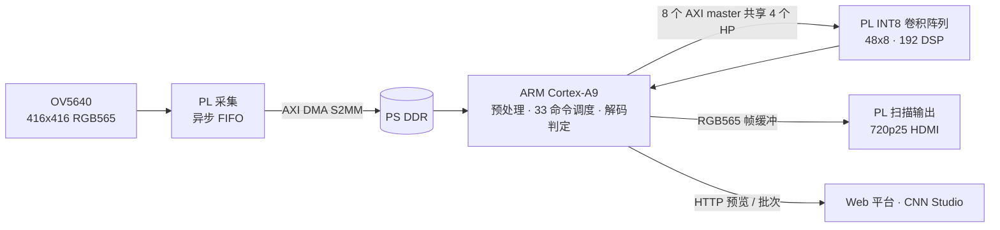

# Zynq-Vision

Zynq-7020 PS-PL 边缘视觉检测系统：OV5640 采集 → PL 加速 INT8 卷积 → ARM 判定 → HDMI 本地显示 + 网络/平台闭环。
作品面向 2026 年全国大学生嵌入式芯片与系统设计竞赛 FPGA 赛道 **自主选题赛道（初级组）**。

- 器件：领航者 V3.9 开发板，**xc7z020clg400-2**（Zynq-7000 SoC）；摄像头 ATK-MC5640 V1.2（OV5640）
- 工具：**Vivado / Vitis 2026.1**（其他版本可复现即可，需在报告中说明）
- 许可：[MIT](LICENSE)

## 1. 作品概述

一块 Zynq-7020 上跑完整的视觉检测闭环，PL 只做算得动的部分，PS 做需要灵活性的部分：

| 环节 | 承担者 | 实现 |
|---|---|---|
| 图像采集 | PL | OV5640 416×416 RGB565，异步 FIFO + AXI DMA 写入 DDR |
| 预处理与调度 | PS（Cortex-A9） | 灰度/色彩校正、33 条算子命令逐条启动 PL、解码与规则判定 |
| CNN 推理 | PL | 48×8 INT8 阵列，双 INT8 打包使 192 个 DSP 承载 384 路乘法，125 MHz |
| 本地显示 | PL | 1280×720 RGB565 扫描输出，25 Hz 面板更新 |
| 远程链路 | PS | HTTP 预览、批次数与模型/产品切换；上位机 CNN Studio 与 Web 平台 |

模型是固定图（33 条算子命令、21 层卷积、224×224 单通道 INT8）。换模型只换参数包与算子图，**不需要重新综合比特流**——这是本作品把「算法迭代」和「硬件迭代」解耦的核心取舍。

## 2. 关键指标

资源与时序取自 [build/report/utilization.rpt](build/report/utilization.rpt)、[build/report/timing.rpt](build/report/timing.rpt)（Vivado 2026.1，2026-10-26，Routed）：

| 项目 | 数值 | 占比 |
|---|---|---|
| Slice LUTs | 45,289 | 85.13% |
| Slice Registers | 61,317 | 57.63% |
| Block RAM Tile | 112.5 | 80.36% |
| DSPs | 217 | 98.64% |
| WNS / WHS | +0.045 ns / +0.050 ns | 主时钟 8.000 ns（125 MHz） |

性能（均为历史实测，条件不同不可混用；详见 [docs/cnn-accelerator-performance.md](docs/cnn-accelerator-performance.md)）：

| 指标 | 数值 | 条件与日期 |
|---|---|---|
| 端到端检测帧率 | 15.21 FPS | RGB 输入 + HDMI 显示开启，连续 121.527 s，2026-10-20 |
| 21 层卷积 | 52.544 ms | 固定输入离线复算，2026-10-27 |
| 33 条算子命令 | 57.607 ms | 同上，含命令交接 |
| ARM 标量 vs PL | 212.30× | 36 次 / 612 次，逐输入等权，2026-10-27；不是端到端 FPS |

> 以上不是当前板卡的实时状态，也不是产线精度结论。上板运行状态需现场重新确认。

## 3. 系统结构



**验证方式**：整网 INT8 逐字节对拍——PS 侧整数参考实现与 PL 输出比对（脚本见 [skill/fpga-engineering-tools/scripts/verify_tensor.py](skill/fpga-engineering-tools/scripts/verify_tensor.py)，历史结果见 [skill/evidence](skill/evidence)）。RTL/HLS 级 testbench 未随包提供，这一项在 [report/REPORT.md](report/REPORT.md) 的「已知缺口」里明示。

## 4. 目录对照

赛事推荐的 `src/ sim/ build/ board/ data/ skill/ report/` 结构与本仓库的对应关系：

| 推荐目录 | 本仓库 | 说明 |
|---|---|---|
| `README.md` | `README.md` | 本文件 |
| `src/` | `hardware/hls/src/` | HLS 卷积/池化/上采样/top |
| | `hardware/camera/*.v`、`hardware/display/*.v` | 采集与 HDMI 扫描 RTL |
| | `camera/` | PS 侧软件：裸机应用、Linux 终端、模型打包 |
| | `apps/`、`packages/` | 平台服务端、Web、移动端 |
| `sim/` | 暂无独立目录 | 验证脚本在 `skill/*/scripts/`，历史结果在 `skill/evidence/` |
| `build/` | `build/report/` | 综合与实现报告（Vivado / HLS） |
| | `hardware/*/build.tcl`、`build.ps1` | 一键构建脚本 |
| `board/` | `camera/terminal/` | Linux 终端运行时（engine / panel / manager） |
| | `vitis_live/` | 裸机 JTAG 路径（XSDB 加载） |
| | `hardware/camera/build/` | 本地生成的 `.bit`（不入库，见第 5 节） |
| `data/` | `camera/int8/weights.bin`、`camera/training/graph.json` | 权重与算子图 |
| | `temporary/arm_pl_stats_20261027/` | 基准原始 CSV 与复算脚本 |
| `skill/` | `skill/` | 7 个可复用技能包 + 证据 |
| `report/` | `report/REPORT.md` | 设计报告 |
| | `docs/` | 详细技术文档与证据索引 |

文件名与目录名全为 ASCII（小写字母、数字、下划线、连字符），中文只出现在文件正文，符合赛事对跨平台复现的要求。

## 5. 复现步骤

前提：Windows + Vivado/Vitis 2026.1（默认装在 `C:/AMDDesignTools/2026.1`；其他路径设 `AMD_TOOLS_ROOT`，或改 `hardware/camera/vivado_env.ps1`）。

```powershell
# 1) 生成 CNN IP（HLS，xc7z020clg400-2，目标 7 ns）
powershell -ExecutionPolicy Bypass -File hardware/hls/build.ps1
#    等价：vitis_hls -f hardware/hls/build.tcl
#    产物：hardware/hls/build/conv/hls/syn/report/conv_csynth.rpt

# 2) 生成硬件工程与比特流（125 MHz，含采集/加速/显示）
powershell -ExecutionPolicy Bypass -File hardware/camera/build.ps1
#    产物：hardware/camera/build/system_wrapper.bit
#          hardware/camera/build/terminal/{utilization,timing,clocks,bus_skew}.rpt

# 3) 构建 PS 侧 Linux 终端
powershell -ExecutionPolicy Bypass -File camera/terminal/build.ps1
powershell -ExecutionPolicy Bypass -File camera/terminal/build-boot.ps1

# 4) 裸机路径（可选）：vitis_live/run_live.tcl 由 XSDB 执行
#    应用与平台配置的可复现入口是 camera/create_app.py

# 5) 平台（可选）：Node.js >= 22.12 + pnpm 10
pnpm install
pnpm dev        # server + web + mobile
```

板端运行需要 SD 卡根文件系统与 QSPI/SD 启动镜像；部署与启动细节见 [docs/deployment.md](docs/deployment.md) 与 [skill/zynq-linux-deploy](skill/zynq-linux-deploy)。

**不随仓库提供的二进制**（体积原因）：`system_wrapper.bit`（约 4 MB）、`camera_live.elf`（约 1.5 MB）、`BOOT.bin`（约 5 MB）——由第 2、3 步在本地生成。

## 6. 文档与证据

| 内容 | 位置 |
|---|---|
| 设计报告（赛事七节结构） | [report/REPORT.md](report/REPORT.md) |
| 技术长文 | [docs/technical_document_complete_20261028.md](docs/technical_document_complete_20261028.md) |
| 性能与 ARM/PL 对比 | [docs/cnn-accelerator-performance.md](docs/cnn-accelerator-performance.md) |
| 架构与接口 | [docs/architecture.md](docs/architecture.md)、[docs/hardware-integration.md](docs/hardware-integration.md) |
| 工程审计与证据索引 | [docs/competition/01_ENGINEERING_AUDIT.md](docs/competition/01_ENGINEERING_AUDIT.md)、[docs/competition/02_EVIDENCE_INDEX.md](docs/competition/02_EVIDENCE_INDEX.md) |
| 可复用技能包 | [skill/README.md](skill/README.md) |
| 综合与实现报告 | [build/report/](build/report/) |

## 7. 许可

本仓库代码以 [MIT](LICENSE) 发布。第三方资源保留各自许可：Noto Sans CJK（SIL OFL 1.1，见 `camera/terminal/assets/fonts/OFL.txt`），XP 主题素材（见 `camera/terminal/assets/xp/` 下的许可文件与 `sources.json`）。数据集与训练权重为作者自建/自训；引用他人模型结构或代码时已在对应文件注明来源。
