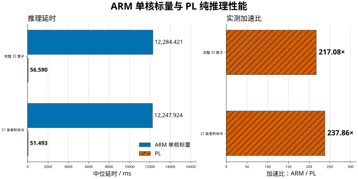

# CNN 加速器性能、两轮优化与 ARM/PL 对比

## ARM编译敏感性完整结果（2026-10-27）

同一纸箱输入、同阶段6轮交错；ARM各条件6次，PL 48次。O0作用于标量参考变体。均为33算子前向中位耗时，双方排除模型加载、输入准备和输出提取，PL包含PS配置与轮询。

| 实现 | n | 中位耗时 ms | 均值 ± SD ms | ARM/PL |
|---|---:|---:|---:|---:|
| ARM O0标量 | 6 | 47,195.384758 | 47,198.250 ± 7.341 | 833.98倍 |
| ARM O3禁向量化 | 6 | 12,011.039459 | 12,010.246 ± 8.282 | 212.25倍 |
| ARM O3自动向量化 | 6 | 12,105.349974 | 12,105.553 ± 1.066 | 213.91倍 |
| PL | 48 | 56.590315 | 56.595889 ± 0.033224 | 1.00倍 |

O0和O3相对PL的比值均为同阶段各自中位数相除；[完整报告](../temporary/arm_pl_stats_20261027/report.md)给出逐输入、全部33算子、原统计检验、漂移和微内核详细结果。

## 当前基线与阅读口径（2026-10-27核对）

当前正式Linux版本为48×8 INT8行读取/解包重叠，加自定义1280×720 RGB565 25 Hz扫描与25 Hz面板更新。正式bitstream `2d18f88f…`、BOOT `13ef13af…`已离线核对；本次未上板。

| 结果 | 21卷积 ms | 33算子 ms | 条件 |
|---|---:|---:|---|
| 第一轮行装载重叠 | 56.915904→54.247131 | 61.985364→59.324442 | A/B/A；普通样本24/12次 |
| 第二轮显示同次对照 | 54.253900→52.567852 | 59.321953→57.633496 | 60→25 Hz；各12次 |
| 最终固化软件复位复测 | 52.543651 | 57.607381 | 显示DMA活动；普通样本12次 |
| 当前无采集/显示的PL | 51.493522 | 56.590492 | 10-27随机交错，PL主试验612次 |

前两行的卷积耗时分别降低4.689%与3.108%；分别按配对试验评价。前三行命令计时为 `setup_ns+start_write_ns+wait_ns`，不是另含插桩观测开销的 `cpu_ns`。纯推理、实时FPS与显示25 Hz不是同一指标。历史10分钟观察和旧24输入试验不升级为最新版结果。

[技术正文及当前图片](../temporary/content_revision_20261026/manuscript.md)、[本次离线复算](../temporary/document_update_20261027/evidence_check.json)。部分旧JSON清单当前缺失，现存CSV、stdout、正式报告及哈希为本次核查依据；不恢复或覆盖用户已有删除。

## 第一轮：2026-10-26 行装载重叠版本

源码：`hardware/hls/src/std_conv.cpp`，SHA-256 `56713764914f861a57d98f91e81ec0ccff6ed198a8d468985b589575df8bcac9`。
已验证 bitstream：`d2727d5564862e6df74e5c2fc8f2a0d3fccec270bfc354deb091fd5bcd017526`。
阵列仍为 48×8 INT8，192 个 DSP 实现 384 路乘法，PL 工作时钟 125 MHz。

`size>14` 输入路径将行 AXI 读取与字节解包拆为两个 DATAFLOW 任务，通过深度 16、宽度 64 位的 SRL FIFO 连接。行数、窗口宽度和每行字数分别受限于现有的 29、33、5，收紧控制位宽以满足 Slice 约束。数值运算、量化、数据布局和既有输入通道组乒乓调度保持不变。

## 诊断边界

- 原外层行循环未流水化，但内部读字、解包循环已经 II=1；`load_compute()` 原本已有组间 DATAFLOW。
- 一个输出块的调度应包含：偏置初始化 + 首组装载 + 中间各组 `max(输入装载, 权重装载, 上组计算)` + 最后一组计算 + 量化/写回 + 控制开销。
- 按当前元数据和实际尾块重算，MAC 发射预算为 25.765 ms；流水填排、偏置初始化、量化发射预算分别约 2.103、0.475、4.077 ms。这些是代码预算，不是硬件计数器实测分解。
- 固定输入板测中，21 条卷积命令的 PS 参数配置约 0.101 ms，启动写入约 0.028 ms。忙轮询与 PL 执行重叠，不能再将整个轮询时间加作 PS 额外开销。插桩观测的完成检测间隔中位数 2.616 μs、最大值 2.742 μs。
- DDR 内部等待没有直接计数；剩余差值不能等同于 DDR 等待。源代码请求载荷约 14.70 MB/帧，平均载荷速率也不能替代 AXI 停顿计数或 DDR 饱和度测量。

## 数值、HLS 与实现

30,400 组装载测试（58,185,600 个字节检查）、20 组完整卷积前后对比、16 个 RTL 场景均通过，覆盖四个物理通道对及整条通道对无效的情况。板端 3 份固定输入共 78 次前向（含预热），每份输出 8,085 个 INT8 值，与归档结果一致。

计算、读取和解包关键循环均为 II=1，计算流水深度仍为 11。HLS 顶层估算为 217 DSP、204 BRAM18K、88,074 FF、119,262 LUT；HLS 估算不能替代下表实际实现资源。

| 布线后项目 | 结果 |
| --- | ---: |
| Slice | 13,296 / 13,300（99.97%） |
| LUT | 45,289 / 53,200 |
| FF | 61,317 / 106,400 |
| DSP | 217 / 220 |
| BRAM Tile（36K） | 112.5 / 140 |
| WNS / WHS | +0.045 / +0.050 ns |
| Setup / hold 失败端点 | 0 / 0 |
| Bus-skew 最小余量 | +6.956 ns |

现有约束仍有 1 个输入和 8 个输出缺少 I/O delay，以上结论限于报告覆盖的检查。第一版使用普通宽控制字段，曾因区域放置差 100 个 Slice 而失败；最终版收紧控制位宽后完成实现。

## 板端 A/B/A 结果

模型为 CAPS-RGB-v1-20261022，模型文件 SHA-256 为 `2658b41a492ab4879a36e38225d0d90d2d41636ec0422f84f78955e958cdbdaa`。
Linux 6.6.159；CPU1 推理；测量期间 governor=performance，面板进程停止、framebuffer 仍活动。每条件 2 次预热，12 次普通轮询样本用于性能统计；另有 12 次插桩轮询样本，不纳入下表。模型装载、输入准备和输出提取不在命令计时内。

| 范围 | 基线中位数 | 优化版中位数 | 耗时降低 |
| --- | ---: | ---: | ---: |
| 21 条卷积命令 | 56.915904 ms | 54.247131 ms | 4.689% |
| 全部 33 条命令 | 61.985364 ms | 59.324442 ms | 4.293% |

基线前后 33 命令中位数漂移为 0.0251%；三个阶段 DMA 地址均为 `0x3c100000`。第 1、6、0、13 条命令的耗时分别下降约 15.66%、10.20%、9.81%、11.27%（命令号从 0 开始）。这不是实时摄像头 FPS 或长期产线稳定性结论。

完整证据位于 `temporary/load_overlap_20261026/`：`result_summary.json`、`board_trial_summary.json`、`board_layer_comparison.csv`、`rtl_verification.json`，以及 `candidate_narrow/implementation/` 下的布线报告和比特流。

## 剩余瓶颈与下一步

1. 大图 1×1 卷积仍受短突发读取、解包和块调度影响。第 6 条命令仍约 4.28 ms，MAC 发射预算约 0.40 ms，尚不能把其余时间全部归为 DDR 等待。
2. 输入尺寸 ≤14 的卷积原合计约 21.38 ms，本轮基本未改善。下一轮应观测权重读取、权重解包及其与计算的重叠。
3. 跨输出块的偏置初始化、计算、量化/写回仍串行。增加输出双缓冲前必须重新核算 BRAM、Slice 和时序，当前仅余 4 个 Slice。
4. 使用临时周期计数或 AXI 观测分别记录输入装载、权重装载、计算活动、暴露等待和写回，再选择下一项改动。保持 48×8 阵列，避免凭理论差值扩大并行度。

## 正式启用与持久启动验证

2026-10-26 已将通过验证的 HLS 工程和 Linux bitstream 更新到正式生成路径 `hardware/hls/build/conv/`、`hardware/camera/build/terminal/`。裸机路径 `hardware/camera/build/system_wrapper.bit` 不属于本次 Linux 交付物。

新版 `camera/terminal/build/delivery/boot/BOOT.bin` 的 SHA-256 为 `de5301d2429f0e566ed07ac8f1f5501ee9a307da31e717a35766191350e7fee6`。复用原 FSBL、U-Boot 和分区头，只替换 FPGA 分区；QSPI 普通及四线读回逐字节一致，SD `/boot/BOOT.bin` 同步更新并核对哈希。

板卡启动模式为 QSPI（BOOT_MODE=1），Linux 内核和根文件系统位于 SD。写入后通过完整系统软件复位，从 QSPI 启动到 SD Linux，未再临时下载 bitstream。新 boot ID 为 `19406669-0a3d-4fa9-ab73-c2d195134489`；125 MHz 时钟配置、16bpp 显示、预览帧递增、模型/产品哈希、累计计数和停止生产状态均已核对。尚未进行断电冷启动或长期稳定性验证。

该次启动后用同一固定输入复测，12 次普通轮询样本的卷积中位数为 **54.242113 ms**，33 条命令为 **59.313562 ms**；另 12 次插桩样本不纳入性能统计。共 26 次前向（含 2 次预热），8,085 个 INT8 输出均与归档结果相同。复测期间 governor=performance、面板暂停，结束后恢复面板、engine 和原 governor=ondemand；不能直接用该命令计时代表实时预览吞吐。

部署前的临时试验脚本错误地重新锁定了 SLCR，部署中出现 SD I/O 与日志中止异常。已修正脚本、解锁 SLCR，在 RAM 救援环境备份完整 SD 两分区和业务数据后离线修复日志/空闲计数及 FAT dirty bit；复查两文件系统均通过，模型、产品、inittab 哈希和业务累计计数与部署前一致。正常启动后根文件系统写入/fsync/读回通过，当次检查未发现新的 MMC、EXT4 或日志错误。后续在 SLCR=0 时再次出现写入错误，说明根因未完成定位，不能仅归因于锁定，见下节。

部署与恢复证据位于 `temporary/load_overlap_deploy_20261026/`：`boot_manifest.json`、`promotion.json`、`postboot_summary.json`、`download/postboot.check.json`、`download/postboot.verification.json`；`sd-backup/` 保留修复前两分区快照及业务数据，`flash-backup/` 保留覆盖范围的原 QSPI 内容，原正式生成文件位于 `before/`。SD 同时保留旧启动镜像 `/boot/BOOT.before-row-overlap-20261026.bin`。

## 最终固化基线：720p25 与面板内存优化

2026-10-26 在上述 HLS 版本上，只改变显示 MMCM：M=49.5、D=8，像素/串行输出分频为 20/4；VCO=618.75 MHz，输出为 30.9375/154.6875 MHz。保留 1650×750 总时序和 1280×720 有效区域，实际扫描率为 25 Hz。这是自定义时序，不能等同于 CTA 标准 720p25；本机外接屏已由用户确认正常。CNN 仍为 48×8、125 MHz，资源和路由保持原版，WNS/WHS 仍为 +0.045/+0.050 ns。

面板将 LVGL 显示/状态刷新及预览轮询限制到 25 Hz，取消 1,843,200 字节 shadow 分配，翻页后从新前台页同步脏区到另一页。双缓冲仍为 RGB565；短检双页一致，未新增欠流。摄像头采集格式、模型输入和 INT8 算术均未改变。

| 同条件固定输入，普通轮询 12 次 | 60 Hz 基线 | 25 Hz 临时版 | 固化后软件复位复测 |
| --- | ---: | ---: | ---: |
| 21 条卷积命令 | 54.253900 ms | 52.567852 ms | 52.543651 ms |
| 全部 33 条命令 | 59.321953 ms | 57.633496 ms | 57.607381 ms |

每阶段另有 2 次预热和 12 次插桩前向，插桩样本不纳入表中统计；输出 8,085 个 INT8 值一致。条件仍是 CPU1、performance governor、面板暂停而显示 DMA 活动。25 Hz 临时版相对同次基线卷积耗时降低 3.108%。实时采集短测另观测到约 60.78→59.02 ms，但条件不同，不能混入固定输入对比。有效像素扫描载荷预算为 110.592→46.080 MB/s（减少 58.33%），这不是 DDR 总流量实测。停止面板/停读 HDMI 的短对照不等同于这次固定输入条件，不能相互替代。

正式源码已同步显示时钟目标和面板实现；正式 `hardware/camera/build/terminal/qualified.dcp`、`routed.dcp`、bitstream/报告与交付 BOOT、rootfs 目录中的面板更新。FSBL、U-Boot 和启动分区头保持原内容，仅替换 FPGA 分区。最终标识：

- bitstream SHA-256：`2d18f88f7679919176049564183a55871d28c67d08f270b22e705c0848330c54`。
- BOOT SHA-256：`13ef13af6355e472bb06ddfad33eee44c532e001c09fe6d495f1ee16b7c9b3c0`。
- 面板 SHA-256：`f020b1fcec62081b5ea9e14b06bb2cc22e8bb158d60f7c15aa6ec082e3a0e02d`。

QSPI 普通/四线读回通过，SD BOOT 与实际面板已持久写入；软件系统复位从 QSPI 进入 SD Linux，boot ID=`c6d30b1e-f96e-48a4-8ddc-b141e8065fab`。启动后不存在面板文件的临时 bind mount，模型/产品/inittab 哈希和累计计数一致，生产停止、governor 恢复 ondemand。断电冷启动、长期运行和真实产线精度未验证。内核 framebuffer 的 `pixclock` 元数据仍沿用旧值，实际扫描以 PL 时钟和时序为准；PS 平台映射未改变，未重建 FSBL/XSA。

本次只更新已列出的硬件启动文件、面板 ELF 和交付 rootfs 目录；现有整盘 SD 镜像、initramfs 和 rootfs 压缩归档未重打包，不作为此基线的新工厂镜像交付。

固化写 SD 时再次出现 I/O 错误，当时 SLCR 锁为 0。停止写入后转入 RAM 环境，模型、产品、inittab 和面板哈希正确；离线 e2fsck/fsck.fat 均返回 0，无需修复。重新初始化控制器后完成 SD BOOT 写入及卸载/重挂载读回；持久启动后又通过 4 MiB 写入、fsync、丢弃文件缓存后读回，之后固定输入推理通过。**这些短检不证明 SD 异常已根治，根因仍未定位。** 不应将该基线称为产线长期稳定性已验证版本。

最终证据位于 `temporary/hdmi25_deploy_20261026/`：`manifest.json`、`postboot_summary.json`、`download/postboot.json`、`download/postboot.verification.json`、`flash-backup/`。旧 SD BOOT 保留为 `/boot/BOOT.before-hdmi25-20261026.bin`；正式生成文件的旧版本保存在该任务 `before/`。试验过程见 `temporary/hdmi25_20261026/experiment_manifest.json`：标准消隐方案的全量路由未完成，增量实现受 BASIC 许可证限制，实际采用的是合格布线文件上的显示时钟修改。

## 无显示与采集的纯推理：既有 ARM 标量基线与 PL

2026-10-26 在同一固化版本上，停止 engine、panel、manager，卸载 framebuffer 驱动，确认摄像头和 HDMI DMA 运行位为 0，并将传感器置为 PWDN；不重新配置 PL、不修改正式 ARM 算法或编译参数。两端均运行同一 CAPS-RGB-v1 模型（SHA `2658b41a…`）和相同的 3×224×224 INT8 输入，CPU1、666.667 MHz、governor=performance，PL=125 MHz。

| 匹配统计范围 | 既有单核 ARM 标量 INT8 | 无显示/采集 PL | 中位延时之比 |
| --- | ---: | ---: | ---: |
| 完整 33 算子（主结果） | 12,284.421 ms | 56.590 ms | **217.08×** |
| 其中 21 条卷积命令 | 12,247.924 ms | 51.493 ms | **237.86×** |

ARM 使用既有 O3 单核标量直接卷积参考，自动向量化关闭、NEON 未启用。原 ELF 的 SHA-256 为 `089a856f804839a50dbf4e111601efb9e75bf67c77afcb61fe7611682a7c2992`，源码与构建参数保持原样。PL 在 Linux 下由 PS 调度，计时包括寄存器配置和完成轮询。两端计时均覆盖相同算子，模型装载、输入准备/复制和输出提取在计时区间之外。

输入预先固定为原回放照片序列前三份（纸箱 `photo_23`、瓶盖 `photo_02`、瓶子 `photo_15`）。每输入 ARM 3 次、PL 100 次，保留全部 9/300 次测量；首输入 ARM 预热 1 次，各输入 PL 预热 3 次。先取每输入中位数，再对三个输入等权取中位数；加速比使用相同范围的中位延时相除。每个 ARM 前向（含预热）和 PL 重复均对拍，输出 8,085 字节一致。统计表给出中位数、均值、样本标准差（SD）和次数；重复分布图展示全部测量及观察范围。

完整 33 算子的等效纯推理吞吐为 ARM 0.0814 次/s、PL 17.671 次/s。完整采集/预览状态另测得约 16.24 FPS。测量后已恢复原 25 Hz HDMI、所有服务和 ondemand，模型/产品/计数及正式文件哈希一致，无新增 SD I/O 错误。

[现存对比数据](../temporary/headless_arm_pl_20261026/comparison.csv)；[逐算子图](../temporary/headless_arm_pl_20261026/figures/layer_latency.svg)、[完整统计表](../temporary/headless_arm_pl_20261026/figures/statistics_table.svg)、[重复分布图](../temporary/headless_arm_pl_20261026/figures/repeat_distribution.svg)。原始数据在 `download/fixed_results.json`，数据表为 `comparison.csv`、`descriptive_statistics.csv`、`raw_timings.csv` 和 `raw_layer_timings.csv`；预先固定条件见 `plan.json`，分析与绘图代码为 `analyze_plot.py`、`render_figures.py`。PNG/SVG/PDF 和导出来源记录均保存在该任务 `figures/`。

## 统计口径的 ARM 与 PL 对比：重复测量、随机交错与假设检验

2026-10-27 在上一节同一固化版本、同一无头 PL 条件、同一出厂标量 ARM 参考上，重做了一次随机交错重复测量对比。与上一节的区别是：不再只报中位数，而是 3 张输入 × 12 轮随机交错、每轮 17 次 PL 重复，共 714 次测量（ARM 42、PL 660），逐次对拍 8,085 字节 INT8 输出，无剔除、无截断。

| 口径 | ARM | PL | 中位延时之比 |
| --- | ---: | ---: | ---: |
| 完整 33 算子（标题，n=36 / 612） | 12,013.94 ms | 56.5905 ms | **212.30×**（逐输入中位数后等权汇总） |
| 仅 21 条卷积 | 11,976.49 ms | 51.4935 ms | **232.58×** |
| 最不利单点配对 | 12,000.05 ms | 56.918 ms | 210.8× |
| `-O0` 构建（敏感性） | 47,195.38 ms | 56.5903 ms | 834.0× |
| `-O3` 自动向量化（敏感性） | 12,105.35 ms | 56.5903 ms | 213.9× |
| 按 NEON 微内核速率推算的 ARM 卷积耗时 | 1,262.58 ms | 51.49 ms | 24.52× |

统计检验：Mann–Whitney `p = 6.0e-24`，Welch（log10）`p = 1.8e-132`，Yuen 20% 截尾均值差 11,954.68 ms（`p = 3.3e-23`），置换检验 5.0e-5（分辨率下限），Cliff's δ = 1.00（两组分布零重叠）。Type II 双因素方差分解给出 η²_条件 = 0.9999998、η²_输入 = 8.5e-11（`p = 0.88`），当前样本量下的最小可检测比值为 1.00086。

三项对报告口径有影响的发现：

- GCC 13.4 在 `-O3 -mcpu=cortex-a9 -mfpu=neon` 下**没有**为这段标量卷积生成任何 NEON（三个 ARM 构建的 `conv_layer` 均为 0 条向量指令）。允许自动向量化构建的测得中位数慢约0.785%；这是当前源码与编译器的结果，不代表手写NEON或优化库的性能。
- 手写NEON微内核实测1.17 MAC/cycle，标量微内核为0.248。PL卷积达到152.99 MAC/cycle，为384峰值的39.8%。按NEON微内核速率换算整个卷积MAC数得到1,262.58 ms及24.52×，只是假设相同有效速率的推算；没有NEON完整网络实测，不能称作严格性能上界，也不再引用无证据的“进一步调优2～4倍后6～12×”。
- 上一节与本节ARM中位数相差约−2.2%，PL接近；测试二进制与内存布局不同，但未通过单因素实验确认差异原因，不能作硬件优化收益。

补充核对：合并全部主试验样本的ARM/PL中位比为212.287379×（212.29×），对应归档BCa 95%区间212.14～212.43；标题212.296174×（212.30×）则先逐输入取中位数再等权汇总。两种估计量分开标注。归档BCa以独立单次运行重采样，并未按轮次聚类；原p值和区间只作同会话探索性描述，不支持跨板、跨模型推断。

新版图片读取同一批原始数据；[合并样本统计表](../temporary/arm_pl_stats_20261027/figures_v2/table1_main.svg)采用212.29×。

经验累积图横轴为各路径耗时相对该路径合并中位数的百分比偏差，用于展示归一化波动；绝对时延由上一张对数横轴图给出。

测量后已恢复显示、采集、三个服务、inittab、governor 与全部持久文件哈希，`dmesg` 无新增 `mmc0`/I/O 错误，生产仍处停止。单板、3 张回放照片、1 个模型，结论不外推到其他板卡或其他网络；未做能耗测量与精度评估。

[完整统计报告](../temporary/arm_pl_stats_20261027/report.md)、[逐算子图](../temporary/arm_pl_stats_20261027/figures/fig3_operators.svg)、[规模律](../temporary/arm_pl_stats_20261027/figures/fig4_scaling.svg)、[稳定性与方差分解](../temporary/arm_pl_stats_20261027/figures/fig5_stability.svg)、[编译敏感性](../temporary/arm_pl_stats_20261027/figures/fig6_sensitivity.svg)、[Roofline](../temporary/arm_pl_stats_20261027/figures/fig7_roofline.svg)、[统计表](../temporary/arm_pl_stats_20261027/figures/table1_statistics.svg)。原始数据 `download/raw_trials.csv`、`download/raw_layers.csv`、`download/raw_calibration.csv`；检验结果 `analysis/tests.json`；预先固定条件 `plan.json`、`schedule.json`；分析与绘图 `analyze.py`、`figures.py`；恢复核对 `download/restored_verify.txt`。
