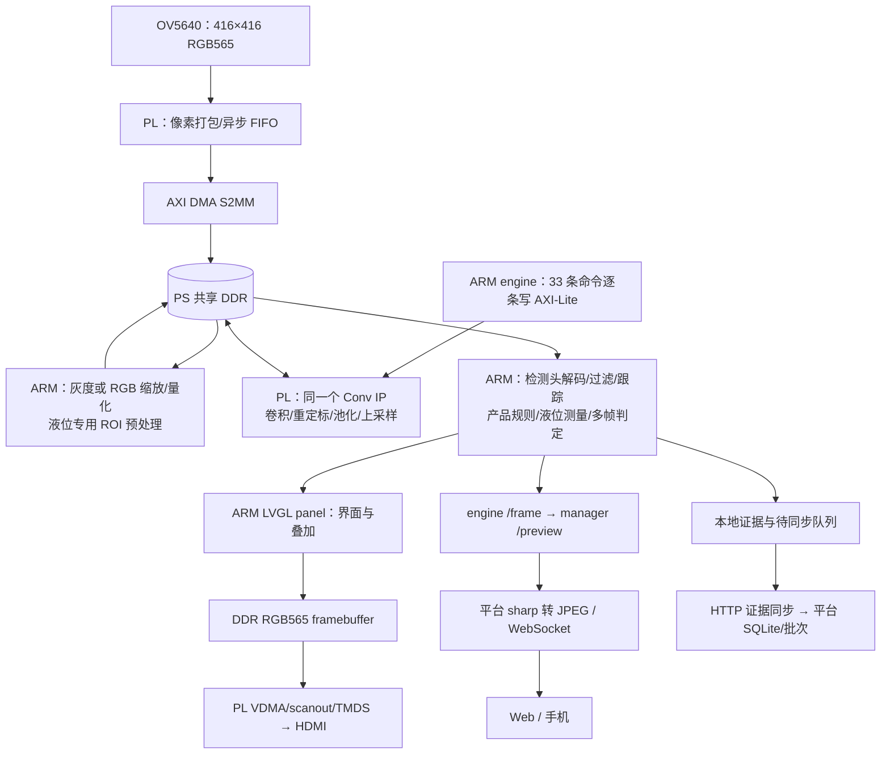

# 阶段一：项目工程事实审计

审计日期：2026-10-25（Asia/Shanghai）。审计对象：`C:/00_workplace/fpga/cnn_accelerator`。代码基准：`5bcc771354f1fe061fc8297c5fed886473d2bbbc`，最近提交日期为 2026-10-24。

本报告只做事实审计，不是最终参赛技术报告，也不决定三分钟视频叙事。结论中的 E 编号对应 [工程事实与证据索引](02_EVIDENCE_INDEX.md)。路径均相对仓库根目录；索引提供可点击来源、函数和检索定位词。

## 1. 审计范围与判定方法

本轮先查看 Git 状态及最近五次提交，再调查当前 HLS、摄像头与显示 RTL、Vivado 集成脚本、Linux 驱动与终端、模型训练导出、平台关键服务，并按这些模块追溯关键提交。未机械展开所有文件、全部历史、完整串口日志或数据库。

- 当前受跟踪文件没有工作区差异；有大量既有未跟踪文件，包括测试产物、模型包和旧文档。未清理、覆盖或暂存它们。
- 本轮未运行 HLS/Vivado/Vitis 构建、未访问板卡、未启停服务、未重测生产、未操作 SD/QSPI。**当前接线、板端实际二进制、加载模型和生产启停状态未现场确认。**
- 本轮独立复核包括：解析实际 Routed/HLS 报告、重新统计 33 条命令类型、重算旧 ARM/PL 采样中位数、校验当前 HLS 文件与既有研究指纹一致、比对正式 terminal bitstream 与历史实验副本 SHA-256，并目视抽查四张截图。
- 只有这两份文档由本轮新建。后续材料不能把“本轮核对了旧测试证据”写成“本轮上板验证通过”。

采用两套独立标签，防止“有代码”与“效果已验证”混为一谈：

| 维度 | 标签与含义 |
|---|---|
| 完成度 | 已实现：代码路径完整；部分实现：有路径但适用范围或闭环有限；未实现：当前路径无该功能；无法确认：缺少足够材料 |
| 结论性质 | 工程事实：源码/原始报告直接支持；历史记录：已有测试或提交的记载；合理推断：明确写出推导条件；设计目标：尚无达成证据 |
| 可信度 | 高：本轮检查到直接源码、原始报告或可核对日志；中：摘要/提交与脚本互相支持，但原始结果或版本关联不完整；低/待确认：缺少直接证据或只有目标性说明 |

“高”只针对表述限定的范围，不自动表示当前板端正在运行，也不代表工业应用已通过验证。[E01](02_EVIDENCE_INDEX.md#e01)

## 2. 竞赛约束：先区分本地指南与最终公告

已直接用 PDF 文本提取核对本地 `temporary/competition_2026/guide.pdf`，共 28 页。以下来自 PDF 第 22～25 页（印刷页 19～22）以及第 28 页，不以已有技术文档的转述为依据。本地文件是题为“全国大学生嵌入式芯片与系统设计竞赛'2026 选题指南（AMD）”的副本；**下载来源链及是否为最新生效版仍待确认**。本轮尝试访问指南所列官网，抓取超时，未用第三方转述代替官方确认。[E02](02_EVIDENCE_INDEX.md#e02)

| 事项 | 本地指南所述约束 | 本工程情况与待办 |
|---|---|---|
| 初级组资格 | 大一至大三在读本科生；混合学历按最高者分组 | 用户目标为初级组；不能从仓库证明队员资格 |
| 器件 | 初级组允许 Zynq-7000 等器件 | 构建目标 `xc7z020clg400-2`，属于对应器件范围；实物丝印仍需拍摄 |
| 实现方式 | RTL、HLS、PS 软件及组合均可；PYNQ 是推荐方向 | 本工程为 HLS/RTL + Linux C++/Python，未发现当前使用 PYNQ Overlay 的证据；无需为迎合推荐方向改造 |
| 工具 | 推荐 2026.1，或 2025.2；其他版本应说明并保证可复现 | 现存 HLS/Vivado 报告显示 2026.1；有对应脚本 |
| 板级验证 | 须板上跑通并提供实测输出 | 有历史上板证据；缺参赛冻结版本的统一证据包 |
| 提交 | 工程、仿真/验证、综合实现报告、上板输出和参考比对、可复现脚本、设计报告 | 内容分散在正式目录与 temporary；部分历史原始产物缺失 |
| 大模型协作 | 需提示词、回答、自我纠错轨迹；提交可复用技能包 | 有 Skill 和 AI 协作元数据/摘要；尚未形成可提交的原始交互记录 |
| 开源 | 原文措辞为“强烈要求”GitHub/Gitee 开源并采用允许再分发的协议 | 未核实公开仓库；未发现项目根许可证；复用来源需补齐 |
| 命名 | 指南要求目录/文件名为小写英文、数字、下划线或连字符；推荐目录结构可替换但需对照 | 仓库有大量 PascalCase/Vue 文件及本地中文材料；提交包命名需另核实和规划，当前不重命名工程 |
| 评分权重 | 创新与应用 30、性能资源 20、正确性完整性 20、大模型协作技能包 15、文档复现 15 | 仅作为这份本地指南的记载；最终《评分细则》可能另有规定 |
| 决赛附加物 | 一页无队伍信息英文 PPT 海报，A4 彩印 | 尚未核实最新模板与提交阶段 |

本地指南未查到“视频不超过 180 秒”的明确条款。本项目按用户要求控制 ≤180 秒；不得将它写成已核实的官方规则。也不能将具身智能赛道的 Ryzen AI PC/ROCm 要求套用到自主选题初级组。

## 3. 项目整体认识与目录地图

**当前可成立的项目定位：在 Zynq-7020 上实现固定 CNN 图的 INT8 硬件推理，并将摄像头采集、本地 HDMI 检测、产品规则、多帧判定和记录同步集成为边缘视觉检测原型。** 应用已扩展到瓶盖计数、液位检测；尚无证据支持“工业级成熟分选设备”或“任意 CNN 通用部署平台”。

| 路径 | 实际内容与技术栈 | 审计定位 |
|---|---|---|
| `hardware/hls/src/` | Vitis HLS C++、`ap_int`、卷积/重定标/池化/上采样 | 当前 FPGA 神经网络算子实现的首要依据 |
| `hardware/camera/` | OV5640 采集 Verilog、XDC、PS/PL 与 DMA 集成 Tcl | 416×416 RGB565 输入链、时钟和共享 DDR 拓扑 |
| `hardware/display/` | VDMA 集成、视频时序、TMDS 编码/串行化、scanout | PL 侧 HDMI 扫描输出，不负责 LVGL 界面绘制 |
| `camera/terminal/` | C++17 engine/panel、Python manager/MQTT、CMake | 当前 Linux 单一检测运行时 |
| `camera/terminal/linux/` | 内核配置、设备树、DMA/fb 驱动、启动及 SD 制作脚本 | 板级 Linux 和持久化启动 |
| `camera/int8/` | 裸机调度、模型库存储、NEON 灰度/RGB 预处理 | 裸机路径仍保留；`gray.cpp` 等也由 Linux engine 复用 |
| `camera/create_app.py`、`vitis_live/` | Vitis 平台/应用生成与 XSDB 脚本 | 裸机链路复现入口；不应当成当前 Linux 唯一入口 |
| `camera/training/` | PyTorch、NumPy、固定图训练、导出和整数参考 | 模型张量布局和 FPGA 数值语义的重要依据 |
| `apps/server/` | Node/TypeScript、NestJS/Fastify、Prisma/SQLite、sharp、WebSocket | 模型/产品/批次/证据管理及图像转码，不是 PL 推理引擎 |
| `apps/web/`、`apps/mobile/` | Vue 3/Vite；移动端 uni-app | 操作与查看；移动相机也可用于采样，不能混称 PL 摄像头 |
| `packages/`、`apps/simulator/` | 共享契约/协议/规则、模拟设备 | 区分 BOARD 与 SIMULATION，避免拿模拟结果证明板级功能 |
| `camera/winui/` | WinUI 3、C# CNN Studio | 早期 UDP 上位机；当前 Linux 平台并非依赖此程序才可推理 |
| 根目录 `basic_*`、`cspdarknet*`、`yolo4_tiny*`，`cnn_app/`、`cnn_accelerator/` | 早期网络封装、工程及参考基线 | 不能据根目录文件直接描述当前 224 INT8 Linux 调用链 |
| `temporary/`、`logs/`、`data/` | 实验、运行记录、模型和素材，部分未跟踪/忽略 | 可用证据须绑定时间、模型和运行时，不能整体当作最终成果 |
| `skill/` | 优化/校验/诊断经验与脚本 | 已形成复用方法，跨题/跨板效果仍需验证 |

依赖依据见 [E03](02_EVIDENCE_INDEX.md#e03)、[E20](02_EVIDENCE_INDEX.md#e20)、[E37](02_EVIDENCE_INDEX.md#e37)。版本号以包清单/锁文件或固定依赖脚本为配置证据，不代表本轮重新安装成功。

## 4. 当前架构、数据流与责任边界

### 4.1 主链路：Linux 独立终端

这张图表达依赖，不表示各阶段全都同时执行或像素流直接穿过 CNN。层间特征图驻 DDR，PS 逐层交接；具体重叠范围见第 5 节。[E04～E16](02_EVIDENCE_INDEX.md#e04)

| 任务 | 实际承担方 | 关键边界 |
|---|---|---|
| 传感器配置 | ARM 通过 GPIO 模拟 SCCB | 传感器 ISP 输出 RGB565；不是 FPGA 自主自动曝光算法 |
| 摄像头像素接入 | PL `ov5640_capture` + XPM 异步 FIFO + AXI DMA | 按行/字计数检查帧，FIFO 处理摄像头与系统时钟跨域 |
| 缩放、通道展开、输入量化、阴影增益 | ARM/NEON，液位另有 ARM 专用路径 | 不宣称这些步骤已全部下沉 PL |
| 神经网络算子 | PL 单一复用 IP | 21 卷积 + 8 重定标 + 3 池化 + 1 上采样 |
| 算子顺序和 DDR 地址 | ARM `Hardware::capture()` | 当前不是 PL 命令表自主执行；也不是所有网络层并行 |
| 解码/NMS 类过滤/跟踪/规则/过件 | ARM `core.cpp`、`passage.h` 等 | PL 输出原始 INT8 头，不直接输出合格判定 |
| 液位位置测量与高低判定 | ARM `level_compat.cpp` | 红标签定位、灰度剖面/阶跃、归一化行阈值共同决定结果 |
| 本地界面绘制 | ARM LVGL + FreeType | PL 承担 framebuffer 搬运、视频时序和 TMDS 输出 |
| 平台预览 | ARM 输出 RGB565，服务端转 JPEG 并推送 | 不把 Web 刷新率等同模型 FPS |
| 外设消息 | manager 的可选 MQTT5 桥 | 有协议与回执逻辑；未证明物理剔除机构闭环 |

### 4.2 两条保留链路不能混写

裸机路径仍由 `camera/create_app.py` 生成 Vitis 应用，`vitis_live/run_live.tcl` 通过 JTAG 加载 bitstream/ELF，PS 用 lwIP/UDP 向 WinUI 输出。BSP 中保留 NEON 中断上下文与中断内释放 lwIP 内存的配置。历史上的 30 FPS 纯预览属于这条链路的特定测试，不等于 Linux 含推理预览达到 30 FPS。[E17](02_EVIDENCE_INDEX.md#e17)、[E33](02_EVIDENCE_INDEX.md#e33)

Linux terminal 构建在 `hardware/camera/build/terminal/` 使用单独含显示的硬件，`camera/terminal` 使用 ARM Linux 工具链。已有 QSPI/SD 自启动及后续 SD 根文件系统持久化记录，足以说明工程曾实现脱离 JTAG 的启动。**两条 JTAG/自启动描述在不同时间和路径下均可成立，不能只依据旧 AGENTS/README 判定当前唯一运行方式。** 不同启动位置是否保存同一最新版 PL/软件，本轮未现场读取。[E18](02_EVIDENCE_INDEX.md#e18)

## 5. FPGA 核心实现审计

### 5.1 固定网络图与数值契约

当前模板接受 `224×224` 单通道或三通道 INT8；输出为 `33×7×7` 和 `33×14×14`，逻辑输出共 8,085 字节。33 通道由每头 3 组 anchor、每组 5 个框参数加 6 类槽组成；六个槽位并不表示每种应用都实际识别六种缺陷。液位模型仅使用 `level_deviation` 等特定类别配置。[E06](02_EVIDENCE_INDEX.md#e06)、[E15](02_EVIDENCE_INDEX.md#e15)

本轮直接统计 `camera/training/graph.json`：14 个 3×3 卷积、7 个 1×1 卷积、8 个重定标、3 个 maxpool、1 个 upsample，共 33 命令。图结构、偏移和量化契约固定，模型加载仅允许首层输入通道 1/3 的对应变化，其他命令须匹配模板。因此可称“同一硬件复用多层、兼容同图不同权重/产品”，不宜称“任意 ONNX/YOLO 网络直接部署”。`upsample.cpp` 固定遍历 128 通道并完成 7→14，是限制的直接例子。

卷积权重/激活是有符号 INT8，INT32 部分和，重定标乘积 INT64，按幅值四舍五入恢复符号，饱和范围 `[-127,127]`。正负两套 multiplier/shift 融合 LeakyReLU 的数值行为；kernel=5 用查表重定标处理分支尺度。不是所有运算都只有 8 位，也不是浮点硬件。[E07](02_EVIDENCE_INDEX.md#e07)

### 5.2 48×8 并行与 DSP 双乘积打包

`std_conv.cpp` 参数：`Tm=48`、`Tn=8`、`Tr=14`、`Tc=16`。输出通道和输入通道并行展开，空间循环流水，3×3 核坐标仍依次轮转。每个有效发射迭代处理一个空间位置、一个核坐标和一组输入通道，对应 384 次 INT8 乘法与 48 路部分和更新。

`multiply_pair()` 将两个权重按 16 位间隔打包，同一个输入乘一次，再从低/高半部取两组乘积并作符号修正。HLS compute 子流水报告为 **192 DSP、achieved II=1、迭代延迟 11 周期**。这些是计算子流水的报告值；不能说“一拍完成整个 3×3 卷积”“11 周期完成一层”或把 192 当整片 DSP 总数。[E08](02_EVIDENCE_INDEX.md#e08)、[E09](02_EVIDENCE_INDEX.md#e09)

历史静态研究对 16,777,216 组 `(input,w0,w1)` 穷举，记录零乘积差异；本轮检查其脚本与结果，并核对其保存的 HLS 源文件 SHA-256 全部仍匹配当前文件。**这证明研究对应当前源代码，不能代替 RTL 协同仿真或板级覆盖。**

按 384 MAC/有效周期 × 125 MHz，可推导理想上限 48 GMAC/s；每 MAC 计两次操作为 96 GOPS。这是忽略补齐、装载、写回、非卷积及调度开销的理论峰值，不是整网实测吞吐。

### 5.3 缓存、分区与数据搬运

- 物理特征采用 CHW，行距 `7→8、14→16、28→32、56→64、112→128、224→256`，64 位 AXI 字装 8 个 INT8。padding 换取完整字访问及移位寻址，不能在对拍前遗漏去 padding。
- 权重导出按 `[M/48,N/8,4,12,8,K,K]` 分块重排并补齐，与四路读和片上 bank 对应。训练导出与硬件读取必须共同维持此契约。
- 逻辑权重缓存 `4×12×128×9=55,296 B`，即 54 KiB。仅在 `out_size>14 && (kernel==1 || ch_in<=128)` 启用；同一输出通道组跨空间块复用，换组重填。不是整模型常驻 BRAM或跨帧免读全部权重。
- 输入/权重 A/B 双缓冲；`load_compute()` DATAFLOW 重叠下一输入通道组装载和上一组计算，有预填充、稳态和排空。`compute_output()` 返回后才 `store_output()`，没有跨所有输出块的完整装载/计算/写回三级重叠。
- 写回子管线另有 DATAFLOW：部分和量化/激活、64 位打包、4 条 depth=32 SRL FIFO、四路 AXI 写回。当前权重双缓冲绑定 LUTRAM，部分和绑定 BRAM，体现资源取舍。

逻辑缓冲容量可由声明推得：输入双缓冲 15,312 B、权重双缓冲 6,912 B、部分和 43,008 B。实际 BRAM/LUTRAM 消耗还受 banking 和综合映射影响，不应直接用逻辑字节换算成精确物理块数。源码旧注释 `TRin=27` 与表达式不符；`Tr=14` 时实际为 29，索引按表达式解释。[E10](02_EVIDENCE_INDEX.md#e10)

### 5.4 PS/PL 接口与 Linux 调度

Conv 有 FM1～4 与 W1～4 八个 AXI Master bundle，经四组互联接 PS HP0～3，**共享一个 PS DDR 系统**。输入/输出共享对应 FM bundle，bias 共用 W1；摄像头 DMA 共享 HP0，显示 VDMA 共享 HP3。不是八条独立 DDR 内存通道。[E05](02_EVIDENCE_INDEX.md#e05)

Linux 驱动 `vision_accel.c` 分配 coherent DMA 内存，限定独占打开，向用户空间映射缓冲和寄存器。`Hardware::capture()` 逐条写地址、形状、算子和启动位并轮询完成；同时异步线程在 CPU0 等采集并预处理下一帧，前一帧像素保留用于显示/证据。`conv_ns` 统计 33 命令的控制交接和 PL 执行区间；`forward_ns` 还包含等待下一帧预处理。两者都不等同传感器曝光到最终判定/显示的端到端延迟。[E11](02_EVIDENCE_INDEX.md#e11)

### 5.5 摄像头、显示与共享带宽

PL 采集将两枚 RGB565 像素打包为 32 位 AXIS，按一帧 86,528 个字产生 TLAST，检查每行 832 字节及 416 行，通过 2,048 深度异步 FIFO 接入系统时钟域。[E04](02_EVIDENCE_INDEX.md#e04)

HDMI 侧提供 1280×720、60 Hz 时序，CPU 绘制的 RGB565 双 framebuffer 经 VDMA 和 TMDS 输出。**60 Hz 是显示扫描制式，不是每秒 60 次 CNN 推理。** 历史优化降低显示带宽并恢复 HP3 互联性能配置后，含显示的检测约 15 FPS；HDMI 与 CNN 的 DDR 争用有可测代价。[E12](02_EVIDENCE_INDEX.md#e12)、[E23](02_EVIDENCE_INDEX.md#e23)

## 6. 应用功能与实际完成度

| 功能 | 完成度 | 已掌握证据与限制 |
|---|---|---|
| 摄像头 → PL 推理 → 本地显示 | 已实现；有历史短时/约两分钟验证 | 源码完整、RGB 黄金输出与回放记录可核对；未现场复测 |
| 灰度/RGB 同图模型切换 | 已实现 | 包头 CRC/SHA/版本/图匹配；仅固定模板；换模型不等于重配置任意网络 |
| GPU 训练、量化导出、整数参考 | 已实现 | PyTorch 固定图训练、量化、manifest 和整型对拍；并非训练发生在 FPGA；训练存在不证明已达到应用精度 |
| 模型、产品规则、生产批次分离 | 已实现；历史闭环通过 | 模型加载不创建批次；START 创建批次；STOP 且 pendingSync=0 关闭；类别顺序核对 |
| 平台/板端启停、单件检查 | 已实现；历史闭环通过 | 自动检测期间手动补检被拒绝，停止后可生成非批次记录 |
| 解码、过滤、跟踪、ROI/数量规则 | 已实现 | ARM 路径，BOX_FILTER_V3；有合成序列验证；不是实体产线检测准确率 |
| 多帧过件决策 | 已实现，应用条件有限 | 完整数量向量共识、进出场和时长门槛，结束保存一件；要求固定相机及分离产品，不能拿单帧框数替代件数 |
| 传送带瓶盖累计计数 | 已实现，真实计数可靠性未定量确认 | 按确认 track ID 在 ROI 内去重累计；与过件质量记录数独立；遮挡/ID 切换/再次进入需专项测量 |
| 液位判定 | 已实现专用路径，广泛效果未验证 | hash 锁定兼容包、红标签裁剪、归一化行测量、85.0～102.9 合格带；未测到液面判低，无标签为复核 |
| 本地证据、断网待传、补传 | 已实现；有历史 API/板级记录 | 证据及序号/模型/产品/批次关联；永久拒绝记录保留 `.rejected` 并跳过；不表示全部历史记录均被平台接受 |
| Web/手机预览与记录 | 已实现 | 主链为 HTTP 二进制 RGB565 → 服务端 JPEG → WebSocket `device.preview.frame`；移动相机生命周期测试不是板端吞吐证据 |
| SD/QSPI 自启动与状态恢复 | 曾实现且有历史验证 | 10-19 冷启动、10-20 SD 根持久化；不同时间产物不得拼成当前统一冻结版本 |
| MQTT 外设联动 | 部分：协议与软件回执链实现 | 当前有 MQTT5 发布、命令、ACK/期限等逻辑；实际 PLC/气缸/剔除动作闭环未确认 |
| Linux 当前固件 OTA | 未在当前终端能力中开放 | `terminalCapabilities.firmwareUpdate=false`；裸机保留 OTA/QSPI 源码不能证明 Linux 支持同等 A/B 升级 |
| 任意网络部署、PYNQ 通用 Overlay | 当前未实现 | 固定图/固定输出模板有明确校验；无当前 PYNQ 实现证据 |
| 工业长稳、量产误检漏检率、功耗能效 | 无法确认 | 缺冻结配置与独立测试集、长时/功耗/实际产线统计 |

功能依据：[E13～E20](02_EVIDENCE_INDEX.md#e13)、[E27～E29](02_EVIDENCE_INDEX.md#e27)、[E33](02_EVIDENCE_INDEX.md#e33)。

典型实际流程是：导入兼容模型并部署 → 分配类别一致的产品/ROI/数量规则 → 确认画面和空场 → 开始自动检测 → 观察/多帧判定 → 本地保存证据 → 在线补传并归入生产批次 → 停止并待队列处理后关闭批次。中断、质量不满足或计数冲突应进入 REVIEW，不能强制包装为 PASS。

液位的重要补充：`level_detections()` 取网络液面框作为显示信息，但用于目标存在/过件的框可由红标签替代，实际高低判定来自灰度测量。**不得表述为“FPGA 神经网络直接精确测得液位毫米值”。** 行阈值是在归一化 224 行图像中的标定，尚不是物理长度。包 manifest 写 LEVEL-ROW-v1.3，而包头仍为 LEVEL-BAND-v1；版本展示必须结合 SHA，不可只凭显示名认定相同模型。[E15](02_EVIDENCE_INDEX.md#e15)

## 7. 性能、资源与正确性证据台账

### 7.1 当前可核对的实现报告

来源为 `hardware/camera/build/terminal/`，报告日期 2026-10-20，Design State=`Routed`；报告头原始路径指向 `temporary/fps_optimize_20261020/hardware_rgb565_default4/`。本轮核对两处 bitstream SHA-256 相同，且与该实验 `final-results.json` 记录相同，建立了较强的产物关联；仍不表示当前板卡/所有启动镜像加载的是该版本。[E21](02_EVIDENCE_INDEX.md#e21)、[E22](02_EVIDENCE_INDEX.md#e22)

| 指标 | 报告值 | 可采用的解释 |
|---|---|---|
| PL FCLK | 125 MHz / 8 ns | 脚本配置与实现检查时钟；HLS 7 ns 目标不能改称当前 142.9 MHz |
| LUT | 45,299 / 53,200，85.15% | terminal 全设计 post-route，占比不是 Conv 核专属 |
| FF | 60,859 / 106,400，57.20% | 同上 |
| BRAM | 112.5 / 140 Tile，80.36% | Tile 为 36K 单位；不能与 HLS BRAM_18K 混计 |
| DSP | 217 / 220，98.64% | 整设计；计算子流水估计 192，剩余部分不能忽略 |
| WNS/WHS | +0.060 / +0.046 ns | 报告内 setup/hold 无失败；余量较小 |
| 总线偏斜 | 4 个摘要条目，最小 slack +6.670 ns | 此报告内相关检查通过 |
| 约束缺口 | 1 输入、8 输出缺少 I/O delay | 不得写“完成全部时序签核”；需查明接口约束适用性 |

HLS 顶层估计 LUT=117,802、DSP=217、BRAM_18K=204；**不能将 HLS LUT 估计与最终实现资源混用**。当前 Vivado 脚本设置 `synth_checkpoint_mode None` 并全局综合；现存 Routed 报告才支持“设计装入 Zynq-7020”。此处仅解释证据层级，不用 HLS 超额估计推翻现存实现，也不将 HLS 估计当作最终资源。[E09](02_EVIDENCE_INDEX.md#e09)

### 7.2 可以引用的历史测量及其边界

| 日期/版本 | 条件与样本 | 结果 | 限制/可信度 |
|---|---|---|---|
| 10-15 灰度 INT8，`e0bcc33` | 同 ELF 基线与成对输入装载候选；固定输入 | 中位 67.442→58.893 ms；5 秒含预览约 15.008 FPS | 提交记载和验证脚本保留，当前相关目录缺原始运行输出；中；不是最新 Linux 液位节拍 |
| 10-20 MILK-RGB-v3，模型 hash `c046d903…` | 125 MHz，Linux engine + panel + RGB565 HDMI，121.527 s | detection 15.2147 FPS；presentation 15.2184 FPS；显示间隔 P95 83.326 ms、最大 116.343 ms | 有原始文本和 JSON；高但仅该测试；不是长稳或单件判定延迟 |
| 同次 10-20 | underflow 计数多次读取均 377 | 测量区间没有新增 underflow | 不能说“累计从未发生下溢”；该优化当时尚未更新 SD/QSPI 启动镜像 |
| 10-22 LEVEL-v3，hash `d64e7b51…` | A9 666.667 MHz/Linux 6.6.159；CPU1 单核标量 INT8 两次；PL `/state.hwConvMs` 15 次 | ARM 原始均值 16,725.7585 ms；PL 原始中位 65.680 ms；约 254.7× | CPU 非 NEON 优化库、运行引擎未停；无最新模型共同输入的同时 PL 对拍；可作限定基准，不作最优 ARM 对比 |
| 同次 10-22 | 15 个 PL 原始样本 | 65.216～76.450 ms | 摘要写 65.67 ms，正文称上限 66.0 ms 均有精度/遗漏问题；采用原始数组，不能隐去 76.450 ms 样本 |
| 10-23 MILK-RGB-v3 | 记录所称 30 s 的 FPS 测量，3 个样本 | 14.9856 / 15.0581 / 15.0667，均值 15.0368 FPS | 无真实过件验证，不证明瓶盖/液位同速；源码/二进制还在继续演进 |
| 10-24 LEVEL-BAND-v1，hash `3aca8253…` | 当前相机场景**无红标签**、生产停止，记录所称 30 s，3 样本 | 7.3066→均值 14.0956 FPS | 高，仅空场优化；不能说有瓶生产 14 FPS；不是本轮重测 |
| 同次 10-24 液位函数 | ARM 固定有瓶 fixture；原引擎仍运行 | 预处理 148.786→77.4082 ms；无标签 131.636→6.12176 ms | 函数 benchmark，不是端到端 FPS；35 案例对比记录字段/hash 一致 |
| 理论推导 | 384 MAC × 125 MHz，理想有效周期 | 48 GMAC/s / 96 GOPS | 推导值；不可挂“整网实测”标识 |

详细来源见 [E23～E26](02_EVIDENCE_INDEX.md#e23)、[E31](02_EVIDENCE_INDEX.md#e31)。不把 1/FPS 当作曝光到显示的延迟，不把单帧推理速度当成每秒产品件数。多帧判定需要目标停留与离场，实际件速还受物理运动、空场门槛、遮挡和证据保存影响。

### 7.3 正确性与准确率是不同证据

10-20 RGB 路径有 `GOLDEN_VERIFY_PASS vectors=6 outputBytes=48510` 和 `pipelineReplay=3` 原始日志，hash 绑定上述 MILK 模型。证明特定输入和回放下的新旧结果一致；不是相对人工标注的检测准确率，也不能覆盖当前液位专用逻辑。[E23](02_EVIDENCE_INDEX.md#e23)

10-22 ARM/PL 比较的“8,085 字节零差异”在 `validate.py` 中是 **C++ CPU 输出与 Python 整数参考** 的对拍。仅凭它不能改写成“当次 PL 与 Python 对所有输入零差异”。早期灰度板测提交另记载 35 阶段/两头/padding/保护区通过，但对应运行输出当前未保留在已查看目录，可信度分开标注。[E24](02_EVIDENCE_INDEX.md#e24)、[E30](02_EVIDENCE_INDEX.md#e30)

跟踪测试记载 97 个合成序列检查、交叉 ID 切换由 2→0；应用规则另有 21 个一致性用例。它们有工程验证价值，不能转换成产线 precision/recall、IDF1/MOTA 或“零漏检”。`all_results_new.json` 341 条记录混有 SIMULATED 帧和无标签样本，缺独立真值，不能以记录总数作为准确率分母。[E27](02_EVIDENCE_INDEX.md#e27)、[E28](02_EVIDENCE_INDEX.md#e28)

## 8. Git 演进、取舍与失败尝试

以下按架构变化筛选，不按提交数量衡量研发。提交说明属于历史记载，原始日志缺失处不提升为当前直接实测证据。

| 阶段/提交 | 关键变化 | 技术原因及结论 |
|---|---|---|
| `0bf4ae4`、`e19a41f`，10-11 | 导入 YOLOv4-tiny 软件/测试，保存作者算子源作基线 | 明确存在复用基础；不能把网络结构和所有原始算子说成本队从零原创 |
| `46ca8b6`、`d4f4e2e`，10-12 | 显式加载分区 bias、修正 pointwise 预取边界 | 关注工具升级、bank 初始化与通道尾部正确性，非仅调大并行度 |
| `ca6a832`，10-12 | 曾采用 142.9 MHz INT16 Conv | 是历史版本；不用于描述当前 INT8 125 MHz |
| `04a96fa`，10-12 | INT16 PL 28 命令自主 sequencer 与权重缓存 | 固定输入 127.941→133.667 ms，端到端 7.37→7.07 FPS；自主调度并未带来加速；可解释为何不宣传“上 PL 必然更快” |
| `56aecb6`、`bec917a`、`bc59dec`，10-13 | 修正测时换算、验证 W8A8、重建 48×8 双乘积阵列及 64 位布局 | 当前 PS 33 命令调度由此形成；不是在原 sequencer 上直接叠加 INT8；量化语义保持和中间阶段对拍是核心难点 |
| `45d6ce0`，10-13 | 权重/重定标/池化搬运优化 | 池化子实验记载固定 forward 90.105→81.088 ms，勿将全部收益归给某一 loader；原始 build 对照缺失待补 |
| `fecf226`，10-15 | 量化参数锁存、SRL FIFO 和四路写回流水 | 记载 81.088→71.673 ms 且黄金阶段通过；早期更快但 hash 错误候选不能列成果 |
| `ad1cbf7`，10-15 | 双 bank 权重搬运与缓存写控制 | 记载 71.673→68.078 ms；组合 7×7 输入缓存候选因布线拥塞停止，未上板，不计性能结果 |
| `de2d083`，10-15 | 连续参数读取、流式直写，选择方案 D | 记载 68.078→67.438 ms；放弃 BRAM FIFO：约少量逻辑收益需多 16 个 BRAM18K；实际 LUT 仅降 439，低于预期，不夸大 |
| `e0bcc33`，10-15 | 成对输入解包、7/14 小图整平面读、摄像头缓冲交接 | 同 ELF 67.442→58.893 ms；神经算术未变，收益来自搬运和流水衔接；曾有单独 UDP 发送错误尚无长期结论 |
| `e52338d`、`1cdac02`，10-15 | 修正裸机 NEON IRQ 保存与 lwIP 中断释放 | 从采集 DDR 正常而接收画面块损坏定位上下文问题；45 s 四次非法释放→100 s 1789 帧零相关错误是限定短测，不是工业长稳 |
| `c432745`～`5a2589f`，10-18～19 | Linux HDMI、驱动、自启动、USB 与鼠标边界 | 显示带宽、USB reset 极性、32/16bpp 产物一致性成为实际板级难点 |
| `089c1cb`、`3e20d23`，10-20 | RGB565 HDMI/15 FPS、模型产品批次分离 | 约两分钟性能和统一运行时闭环；平台服务扩展不是 FPGA 新算子 |
| `b11f758`、`baac8b2`，10-21 | 过滤、跟踪、空场与多帧过件共识 | 从逐帧检测发展为可复核的单件证据；不代表产线精度已有量化 |
| `8bec151`、`c7bc478`，10-23～24 | 液位兼容、预处理优化及终端/手机相关工作纳入仓库 | 当前液位是专用兼容路径；提交是 checkpoint，不能从单一标题推断全部测试范围 |
| `8e7622f`、`a5108f3`、`5bcc771`，10-24 | track ID 瓶盖累计、预览组装修复、永久拒绝记录跳过 | 与真实数据链/显示有关；永久拒绝仍保留证据，不能把队列清零当作全部成功入库 |

来源见 [E30～E34](02_EVIDENCE_INDEX.md#e30)。各行跨阶段的数字不具备完全相同的模型/输入/软件条件，**不可拼成统一连续加速曲线**；需要冻结基线和配对数据才能做最终对比图。

## 9. 原创工作、复用与 AI 辅助的可证范围

能从当前源码及差异确认的工程工作包括：将既有网络的数值语义重建为固定 INT8 图；48×8 打包计算和数据布局协同；片上存储/总线装载/写回取舍；PS 采集预处理与 PL 执行交接；Linux DMA/framebuffer、启动、显示与检测一体化；在原始框输出之上实现多帧规则和证据追溯。它们适合表述为**本工程的具体实现与优化贡献**，不能无检索和引用就声称首次提出、国际首创或原创 YOLO。

明确复用的基础包括 YOLOv4-tiny 结构/原作者算子、AMD HLS/PS/DMA/VDMA/XPM 工具和 IP，以及 PyTorch、LVGL、FreeType、nlohmann/json、cpp-httplib、Paho、Vue、NestJS/Prisma 等。终端依赖有固定 tag/commit；UI 的 XP 素材另附许可证。复用软件不降低集成工作的事实价值，但需说明来源和许可，不能把工具自带功能算作自研算法。[E35](02_EVIDENCE_INDEX.md#e35)、[E37](02_EVIDENCE_INDEX.md#e37)

最新提交存在 `Co-Authored-By: Claude Code`，仓库有 `AGENTS.md` 和两个 FPGA Skill 包；`references/evidence.md` 明确说协作部分是摘要，不是逐字聊天导出。可确认 AI 辅助工作流存在，**不能由提交作者字段推断每行代码由人或 AI 编写，也无法据此认定某项技术决策由某个成员独立作出**。后续应由队员核对并提供自己可授权公开的原始提示、回答、纠错与提交关联，不读取或复制无关私人会话。[E36](02_EVIDENCE_INDEX.md#e36)

Skill 已整理黄金参考、资源时序门槛、失败候选和上下文诊断脚本，有复用价值；`skill/README.md` 已说明包结构、使用方式、来源和失效条件。尚无已验证跨题/跨板或通用 PYNQ Overlay 的实测证据，不能提前承诺 PYNQ 通用技能加分已成立。

## 10. 现有材料与证据冲突

| 现有材料 | 本轮发现 | 参赛处理建议 |
|---|---|---|
| `PROJECT_GUIDE.md`（10-11） | 描述 416 RGB/INT16 早期形态，称摄像头/UDP/解码待接入 | 仅作历史说明，当前后处理与摄像头已实现，不照搬完成度 |
| `AGENTS.md` | 同时保存早期灰度/JTAG约定及后期 Linux/液位进度，含“未提交”等时间性备注 | 用当前源码/Git/对应测试校正；不把备注当现场状态 |
| 未跟踪 `docs/TECHNICAL_BASELINE_SPECIFICATION.md` | 工业级表述、30 ms/30 FPS 目标、裸机与 Linux、OTA等混写 | 30 ms 属目标，无当前达成证据；不直接升级为竞赛事实 |
| 10-22 ARM/PL `report.md` | PL 区间称 65.2～66.0 ms，但原始数组有 76.450 ms | 使用原始 15 次范围和重算中位数；CPU 标量限定不可省略 |
| `Showcase.vue` 和展示页截图 | 实时帧/遥测与历史 ARM/PL常量、Routed 资源混在同页；截图当前 CAPS，页脚基准 LEVEL-v3 | 必须标明不同来源；静态动画中的帧数不是硬件计数器实测；`fps×0.9775` 是估算，不是 PL 计数器 |
| `temporary/showcase_redesign_20261024/real_pass.png` | 目视检查为全白图 | 文件名不构成成功证据，不采用 |
| `temporary/terminal_redesign_20261024/screen.png` 与 `preview-main.png` | 有终端实画面，但相机为桌面场景，显示 REVIEW、待同步 3 和同步异常 | 证明 UI 状态，不证明瓶盖检测成功或同步闭环完成，成功展示应另采 |
| `temporary/video_demo_20261024/样片-平台巡览.mp4` | 文件存在，约 13.9 MB；本轮未逐帧审看 | 仅登记可用性，不认定可直接交片或其每处数据正确 |
| 液位 `deployment-verification.json`（10-22） | 较早 band=[85,98.5]、旧 hash，实瓶瞬态框裁切且明确不计物理验证 | 当前 band=[85,102.9]/新 hash 以源码为准；不得把旧回放替代当前完整实瓶验收 |
| 10-20 性能与后续自启动记录 | 性能测试时声明 boot 未更新，后来有 SD 持久化记录 | 仅说明先后演进；没有“同一次最新版冷启动+性能”全链证据 |

详见 [E38～E40](02_EVIDENCE_INDEX.md#e38)。本轮不修改这些旧文件或展示代码。

## 11. 当前最值得展示的技术事实

以下是审计选出的候选亮点，供用户审核后进入阶段二，不构成已定稿叙事：

1. **有限器件上的 INT8 并行计算与数值一致性。** 192 DSP 计算子流水实现 384 路乘法，整设计使用 217/220 DSP；高资源占用让布局、存储和时序取舍具有实际约束。
2. **算力与数据通路共同优化。** 64 位打包、通道/行补齐、权重重排、有限片上复用、输入/权重双缓冲和流式写回可通过源码与报告串联解释，而不只展示一个峰值数字。
3. **PS/PL 协作形成可运行原型。** PL 算子与采集/显示、ARM 预处理/后处理和 Linux 内存驱动协作，有约两分钟 RGB 检测/显示证据；需将推理、显示与件速分开。
4. **先正确再优化的工程方法。** 黄金输出、padding/保护区、失败候选退出、资源/时序门槛及 IRQ/lwIP 故障定位，体现工程深度；缺失的早期原始日志应坦诚标注。
5. **从逐帧预测到单件可复核证据。** 产品规则、多帧共识、REVIEW、模型/产品/批次分离和本地补传支持应用完整性，但不取代 FPGA 核心主线。

## 12. 证据缺口与下一阶段入口

| 优先级 | 缺口 | 补齐后可支持的说法/画面 |
|---|---|---|
| P0 | 明确最终应用主场景与冻结版本：HEAD、实际 boot 来源、bitstream、engine/panel/manager、模型包 SHA、产品规则 | 所有演示、资源与性能数据对应同一套可复现系统 |
| P0 | 固定照明/视角，有真值的连续实物操作：空场、合格、异常、离场落记录 | 核心效果及“从采集到判定、追溯”的真实闭环；液位需高/合格/低/无液面，瓶盖需已知数量和遮挡边界 |
| P0 | 实物板卡/芯片/相机及接口全景；同框拍物体运动和 HDMI，另录原生 UI | 证明 FPGA 实际参与，避免纯录屏看不出硬件 |
| P0 | 最新场景同时采集推理区间、帧吞吐、显示间隔和单件完成延迟，记录样本数及开关条件 | 一个有边界、可复核的性能主数字；无需为此先重新综合 |
| P0 | 当前模型正确导入/分配后成功与失败记录、平台回执/批次闭合；检查永久拒绝证据 | 确保演示不被版本不匹配和队列异常打断；本轮未检查生产数据库 |
| P1 | 队员提供独立测试集、标注与场景划分、误检漏检统计；相邻帧和模拟数据不能当独立验证 | 准确率/计数误差等定量应用效果 |
| P1 | 统一归档报告、hash 清单、黄金输入/输出和原始日志；追补缺失的早期配对结果或不用该数字 | 原创优化的可复测前后对比；不再依赖提交文字 |
| P1 | 现存 1 输入/8 输出无 I/O delay 的接口解释或后续约束核实 | 准确表达时序收敛范围；无需本轮改硬件 |
| P1 | 冷启动完整实录，并核对与性能版本相同；断网本地检测和恢复补传录制 | 无 JTAG 自主运行及离线闭环的当前证据 |
| P1 | 官方最终规则/评分细则/模板、成员资格、代码/模型来源许可、AI 原始记录；将已有 Skill 总说明与原始记录/跨场景验证关联 | 完整且合规的参赛交付 |
| P2 | 长时稳定性、实际运动速度/触发/剔除成功率、功耗温度 | 如不补测，最终材料明确不主张这些指标 |

阶段二建议先在“瓶盖计数”与“液位判定”中选择证据最完整的主场景，再确定 3～5 个亮点。当前可以立刻使用的 FPGA 原理/报告证据较强，成功实物演示证据较弱。若选择液位，必须解释 ARM 专用测量的实际贡献；若选择瓶盖，应分开本帧目标数、传送带累计数和多帧检测记录件数。

**本轮到阶段一结束。待用户审核事实、主场景和证据取舍后，再编写阶段二叙事；未生成阶段二至五文件。**
