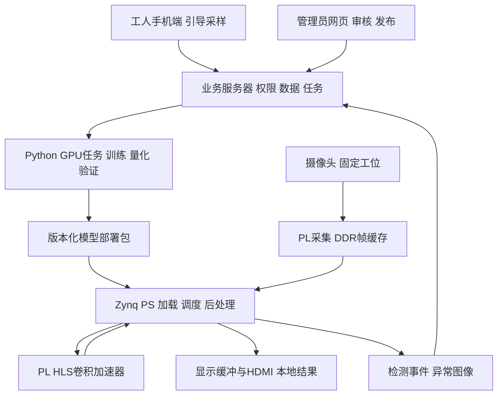
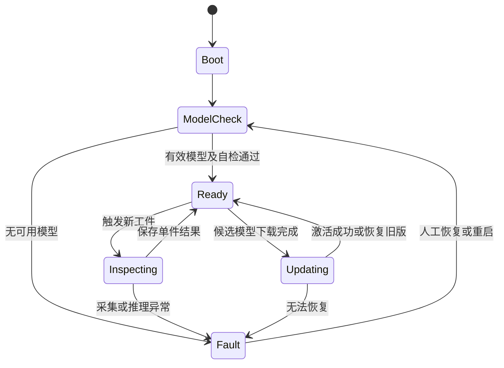

# 基于 Zynq 7020 的可配置边缘视觉质检系统设计文档

面向小批量生产的采样训练与部署闭环

| 项目 | 内容 |
| --- | --- |
| 文档版本 | 0.2 |
| 编制日期 | 2026 年 10 月 15 日 |
| 修订说明 | 0.2 版据首轮源码核对与团队确认修订：补正 §2.1 的逐帧 UDP 耦合、预处理配方、网络基座与类别来源；明确训练工程位于其他机器；FR07 降为 P1；§3.1 与 §9.2 由按键触发改为连续检查与边沿计件；新增 §7.2 输入规格决策；§12、§13、§14、§15 相应调整 |
| 面向读者 | 项目开发成员、指导教师、竞赛评审准备人员 |
| 竞赛方向 | 全国大学生嵌入式芯片与系统设计竞赛 FPGA 创新设计赛道 AMD 自主选题初级组 |
| 工程基线 | `cnn_accelerator`，核对提交 `1cdac02` |
| 硬件基线 | 正点原子领航者 V3.9，Zynq-7020，ATK-MC5640 V1.2 摄像头 |
| 本版用途 | 确定竞赛原型范围、技术边界、模块接口、开发顺序和验收方法 |

本文将原有 CNN 加速工程扩展为可配置的视觉质检系统。工人通过手机或网页完成引导采样，管理员审核数据并发起训练，本地 GPU 服务器生成兼容端侧硬件的模型部署包，Zynq 终端在本地完成识别、业务判定和结果显示。系统以少量现场样本适配、固定加速器上的模型更新、断网运行和结果追溯为主要建设目标。

竞赛原型建议以牛奶盒包装完整性检查为主场景，以日用品托盘配装检查为补充，并以乒乓球可见表面检查作为换型扩展。本文中的功能安排、性能门槛和日期计划属于设计目标，不表示已实现或已通过测试；样品组合与目标门槛在首轮实验后冻结。

## 目录

1. [项目目标与竞赛约束](#1-项目目标与竞赛约束)
2. [当前工程基线](#2-当前工程基线)
3. [应用场景与检测边界](#3-应用场景与检测边界)
4. [需求与交付范围](#4-需求与交付范围)
5. [总体架构与职责](#5-总体架构与职责)
6. [数据采集与样本管理](#6-数据采集与样本管理)
7. [模型训练与硬件适配](#7-模型训练与硬件适配)
8. [部署包与可靠更新](#8-部署包与可靠更新)
9. [端侧运行与本地显示](#9-端侧运行与本地显示)
10. [服务器与客户端](#10-服务器与客户端)
11. [接口与数据约定](#11-接口与数据约定)
12. [测试与验收](#12-测试与验收)
13. [实施计划与分工](#13-实施计划与分工)
14. [竞赛展示与技术贡献](#14-竞赛展示与技术贡献)
15. [风险与待确认事项](#15-风险与待确认事项)
16. [参考资料](#16-参考资料)

## 1 项目目标与竞赛约束

### 1.1 产品定位

目标用户是缺少专职视觉算法人员的小微制造企业、包装工位和小批量配装工位。系统提供一条可重复的使用流程：建立检测方案、采集样本、审核训练、批准发布、现场检测、复核改进。

“可配置”指在已验证的网络模板、成像条件和算子能力范围内，调整产品类别、模型权重、检测区域和业务规则。“通用”作为平台扩展方向，不承诺任意材料、任意缺陷或任意神经网络均能直接运行。

竞赛阶段使用日用品验证方法和工程闭环。向真实工厂推广时，仍需根据工件、节拍、镜头、光源和缺陷标准重新开展现场验证。

### 1.2 建设目标

- 将现有摄像头与 HLS 推理链路扩展为能独立运行的检测终端。
- 建立从训练检查点到自定义 INT8 硬件格式的可重复导出流程。
- 在同一份兼容 bitstream 上加载不同模型，展示真实换型。
- 通过手机或网页降低采样、标注和发布操作难度。
- 保留检测结果、模型版本与异常图像的关联，支持人工复核。
- 用实测精度、性能、资源和异常恢复结果支撑项目价值。

### 1.3 赛事要求

2026 年 AMD 指南第 3.3 节允许使用 RTL、Vitis HLS、PS 软件及其组合。初级组面向大一至大三本科生；混合年级或学历队伍按最高者归组。Zynq-7000 属于允许的器件范围。PYNQ 是推荐方向，不是现有工程必须迁移的前提。[R1]

| 评测项 | 指南权重 | 本项目应准备的证据 |
| --- | ---: | --- |
| 创新性与应用价值 | 30 | 具体质检问题、换型流程、适用边界和用户操作成本 |
| 性能与资源优化效果 | 20 | 同任务基线对照、实现资源、时序和上板性能 |
| 功能正确性与设计完整性 | 20 | 采样到部署闭环、板端参考比对、异常恢复 |
| 大模型协作与技能包 | 15 | 真实协作过程、失败分析、可复用校验工具 |
| 文档质量与可复现性 | 15 | 构建入口、依赖版本、数据定义和复现步骤 |

指南要求提供工程、验证结果、实现报告、上板输出与可复现脚本，并提交大模型协作记录和 `skill/` 技能包；对开源的原文表述为“强烈要求”。提交前应核对参考代码、训练代码和权重的来源及分发条件，区分参考设计与团队新增贡献。[R1]

本项目已确定采用全工程开源。这使得上述授权核实从建议项变为提交前的必要前置：参考工程（含 `vitis_postprocess`）、原始 darknet 权重与公开数据集均需确认分发条件，未确认前不能进入公开仓库。

公开通知列出的作品提交时间为 2026 年 11 月 4 日 18:00，决赛为 11 月 20 至 22 日。本文按 10 月 15 日起约 20 天安排原型开发，最终节点以组委会及报名平台最新通知为准。决赛还包含 FPGA 基础编程设计能力考核。[R2]

## 2 当前工程基线

### 2.1 已核实的软件结构

现有链路为：OV5640 摄像头 → PL 采集 → DDR → PS 灰度预处理与调度 → PL 卷积 → PS UDP → CNN Studio 上位机。

| 项目 | 当前源码事实 | 对后续设计的影响 |
| --- | --- | --- |
| 采集格式 | 416×416 RGB565 | 原始帧可用于预览和样本留存 |
| 模型输入 | 224×224 单通道 INT8 | 训练和导出必须采用一致预处理 |
| 特征行跨度 | 输入写入特征区时每行占 256 字节 | 256 不代表当前模型图像宽度 |
| 调度数量 | `command_count=33` | 第一版固定已验证网络模板 |
| 权重长度 | `weight_bytes=6350208` | 文件长度和加载空间必须校验 |
| 特征区长度 | `feature_bytes=3012640` | 调度偏移不得越界 |
| 元数据长度 | `metadata_words=16506` 个 32 位字 | 不可仅替换权重而忽略元数据 |
| 输入预处理 | 416→224 灰度缩放为硬编码 Q22 多相双三次滤波（`gray_coefficients.h`），系数由 `temporary/int8_model_test/prepare_gray.py` 生成；该脚本同时用 Pillow 独立复算并输出校验哈希 | 训练侧必须复用同一配方，不能改用图像库默认缩放；已有验证过的参考实现，ROI 改动的落点是重新生成系数表 |
| 检测头 | 7×7 和 14×14，当前按六类解码 | 类别、anchors、输出尺度必须随模型匹配 |
| 网络基座 | 两路 anchors 与 darknet 官方 `yolov4-tiny.cfg` 的 mask 1,2,3 / 3,4,5 逐项吻合 | 训练基座是标准 YOLOv4-tiny，导出可参照公开工具链 |
| 当前类别 | 龟裂、夹杂、斑块、麻点、轧入氧化皮、划痕，与公开数据集 NEU-DET 的六类钢材表面缺陷同名同序 | 权重来自钢材缺陷领域，对包装任务无迁移价值；基础数据规模应按公开数据集表述 |
| 权重来源 | `weights.S` 将权重及元数据链接进 ELF | SD 文件加载尚需开发 |
| 检测后处理 | WinUI 执行解码和 NMS；`camera/desktop/postprocess.py` 是同一套算法的 Python 版，注释标出上游 `vitis_postprocess/src/nms.cpp` 出处 | 迁移到 PS 属于移植而非重写，已有 C# 与 Python 两份参考 |
| 运行前置条件 | 推理由上位机逐帧驱动：`live_main.cpp:98` 每次迭代停在 `udp_running()`，`:99` 亮度与 `:103` 的 `udp_camera_only()` 同样来自客户端 | 独立检测需把主循环重构为本地触发状态机，不是删去启动前的等待 |
| 软件平台 | standalone 与 lwIP；TCP、DHCP 配置为关闭 | 模型下载和设备管理需增加通信能力 |

工程依据：`camera/camera_input.h`、`camera/int8/live_main.cpp`、`camera/int8/model.h`、`camera/int8/weights.S`、`camera/int8/gray.cpp`、`camera/int8/gray_coefficients.h`、`camera/winui/Postprocess.cs`、`camera/desktop/postprocess.py`、`camera/create_app.py`、`hardware/camera/base_system.tcl`、`temporary/int8_model_test/prepare_gray.py`。

### 2.2 已知进展与待验证能力

团队报告已有约 16.6 FPS 的实时检测表现；工程接手记录包含约 100 秒短测结果及尚待确认的间歇画面偏绿问题。本设计文档未重新上板测量，因此不将该速度作为完整产品的验收结果，也不据短测声明长期稳定。

当前正式加载方式为 JTAG。SD 模型加载、SD 上电启动、HDMI、PS 独立后处理、网络模型更新和自动训练闭环均需逐项验证。块设计的入口是 `hardware/camera/build.tcl`，它在 `:9` 载入 `base_system.tcl` 后再追加摄像头通路。SD 启动具备硬件基础：PS7 已使能 SD0（MIO 40–45，卡检测在 MIO 10）与 UART0（MIO 14–15）。显示通路则是零基础：整个设计中没有任何 VDMA、像素时钟约束或串行化 IP。

外部触发输入同样没有余量。设计中唯一的 `axi_gpio`（`build.tcl:16-17`）是 5 位输出接 `camera/control`、4 位输入接 `camera/status`，全部被 `ov5640_capture` 占用，且没有中断汇聚逻辑。若要接入光电开关或编码器一类的外部触发，需要新增 PL 引脚与 `camera.xdc` 约束、对应的 PL 逻辑，以及 PL 到 PS 的送达手段，并重新执行 Vivado 综合与实现。这属于 §5.1 所说的硬件接口修改，不在“固定 PL”范围内。

本次定点核对在本仓库内未找到训练入口与可微调检查点；据团队说明，训练工程位于其他机器，本仓库只保留导出后的权重与元数据。因此 §7 的前置工作不是重建训练链，而是确认那台机器上工程的框架、版本，以及其导出脚本能否复现当前格式。已知基座是标准 darknet YOLOv4-tiny，导出不是从零反推。

### 2.3 工程约束

- 在实际开发仓库内实施，保留同级作者参考工程及用户已有修改。
- 保留 `FPU_HARD_FLOAT_ABI_ENABLED=1` 与 `LWIP_ALLOW_MEM_FREE_FROM_OTHER_CONTEXT=1`；配置入口位于 `camera/create_app.py`。
- 软件修改优先复用平台构建应用；硬件集成发生变化时才重建 HLS 或 Vivado。
- 测试代码和输出放入 `temporary/<任务名>/`，避免混入正式推理代码。
- HLS 估算、实现通过、板端正确性与实测性能分别报告。
- 当前链路使用的静态地址属于已有点对点测试配置；接入路由器时应按实际网络重新配置，不能直接认为已经具备互联网接入能力。

## 3 应用场景与检测边界

### 3.1 主场景 牛奶盒包装完整性检查

采用固定支架、柔和补光、哑光背景。设备持续采集与推理，同一工件在视野内的多帧结果归并为一件。系统检测盒体、吸管和指定标签，并结合区域规则输出结果。

当前尚无传送装置，工件需人工传递通过视野。这带来两点限制，必须在材料中如实表述：一是“流水线”在竞赛阶段只能表述为模拟产线；二是 §12 的计件正确率与节拍无法取得有意义的实测值，因为已知件数的过件测试需要速度可重复的传动。因此把传动列为工位搭建的一部分：动力带、带调速的直流电机，或靠重力下滑的倾斜滑道都可接受，关键不在速度高低，而在每一件的过件速度可重复。

首版只做判定、显示与记录，不驱动物理剔除执行机构。判定为不通过的工件需要人工取走，这一点应在对外表述中说明，不能把“检出”等同于“已剔除”。

| 状态 | 判定条件 | 用户显示 |
| --- | --- | --- |
| 通过 | 图像有效、产品位置正确、必需部件满足规则 | 包装检查通过 |
| 不通过 | 在有效检查条件下，吸管或标签缺失，或位置违反规则 | 缺吸管、缺标签或位置错误 |
| 待复核 | 遮挡、明显模糊、姿态超范围或证据不足 | 提示该件人工复核 |
| 设备异常 | 摄像头、推理、存储或模型状态异常 | 检测暂停及异常原因 |

未检测到产品、图像失效或推理超时不得被解释为“无缺陷”。缺件判定只能在产品存在且视角有效的前提下进行。低置信度不等于已识别出未知类别，不承诺开放集识别能力。

吸管在 224×224 图像中的可见尺寸是第一轮实验重点。若细节不足，应先调整视野和工位；如引入 ROI 裁剪，必须同步更新训练预处理、坐标变换和部署包约定。

### 3.2 补充场景 日用品托盘配装检查

在固定托盘内设置产品区域，检查牛奶盒和火腿肠的种类、数量及摆放位置。例如，一个指定配装方案要求一个牛奶盒和两根火腿肠，少件、错放和数量不符均判为不通过。

该场景用于展示同一设备上的业务规则配置。若仅修改数量规则而未训练或加载新模型，应表述为“方案切换”；只有加载了真实的新模型部署包，才作为“模型换型”证据。

### 3.3 扩展场景 乒乓球可见表面检查

使用托座固定乒乓球，先验证明显污渍、较大破损或可见变形。单相机静态画面只覆盖当前可见区域。全表面检查需要旋转、多视角或多相机，属于后续扩展。

人工模拟样本应标记构造方式。训练和测试不能只依赖同一个球、同一种贴纸或同一种画线方法，防止模型学习到样本制作方式而非目标缺陷。

### 3.4 首版不覆盖的任务

内部品质、材料成分、密封气密性、细微裂纹、微小文字 OCR、任意姿态全表面检测和高速连续分拣不作为首版承诺。食品包装样品用于验证可见外观和配装，不用于推断食品内部品质。

以视野横向覆盖 200 mm 为例，224 像素对应约 0.89 mm/像素，1 mm 细节仅约 1.1 像素。该几何估算还未计入模糊与对比度损失，不能据此直接给出缺陷检出下限。实际下限必须使用带尺寸标注的样品测得。

## 4 需求与交付范围

P0 表示完整竞赛原型的必要能力，P1 表示核心链路稳定后增加的能力。优先级不代表当前已实现。

| 编号 | 需求 | 优先级 | 验收证据 |
| --- | --- | --- | --- |
| FR01 | 创建检测方案并设置类别、区域和判定规则 | P0 | 配置记录及对应现场判定 |
| FR02 | 手机控制板端采样、上传和人工标注 | P0 | 原始图、标签及采集元数据 |
| FR03 | 管理员审核数据并冻结版本 | P0 | 审核状态与不可变数据版本 |
| FR04 | 服务器执行真实训练、量化和导出任务 | P0 | 检查点、日志、评估和部署包 |
| FR05 | 网络下发部署包并写入 SD | P0 | 下载、校验和设备确认记录 |
| FR06 | PS 本地后处理与单件业务判定 | P0 | 无上位机条件下输出结果 |
| FR07 | HDMI 显示图像、结果和设备状态 | P1 | 板端显示及并发运行测试 |
| FR08 | 重启加载有效版本，断网继续检测 | P0 | 重启与断网测试记录 |
| FR09 | 更新失败保留原模型，支持版本回退 | P0 | 故障注入与恢复记录 |
| FR10 | 检测事件关联模型、方案和异常图片 | P0 | 记录检索与帧号一致性检查 |
| FR11 | 同一 bitstream 加载第二个兼容模型 | P1 | bitstream 哈希及两组模型结果 |
| FR12 | 手机直接拍照、采样质量提示 | P1 | 跨设备测试与浏览器适配结果 |
| FR13 | 人工复核样本进入下一版训练 | P1 | 复核记录与新数据版本关联 |

首版客户端只设置工人和管理员两个角色。训练框架、网络模板和硬件参数由开发者维护，工人界面不暴露学习率、DDR 地址或量化尺度。

公网远程服务、多租户计费、多设备批量发布、复杂机械分拣、未知缺陷检测和全面移动端适配列为后续方向，不占用主闭环开发时间。

## 5 总体架构与职责

### 5.1 边缘终端

PL 负责摄像头接入、已支持算子的加速计算和新增的视频输出逻辑。PS 负责图像预处理、加速器调度、模型加载、解码与 NMS、业务规则、SD 存储和设备通信。

“固定 PL”指模型更新期间不重综合、不重新下载 bitstream。首次集成 HDMI、调整采集链路或修改硬件接口仍可能需要更新 PL 设计。

### 5.2 本地训练与管理服务器

笔记本承担业务管理与 GPU 训练。系统在逻辑上支持未来迁移到远程服务器；竞赛阶段以局域网本地部署为准，不将笔记本原型描述为已经具备弹性云服务能力。

Node.js 可负责权限、文件上传、任务管理和设备管理，独立 Python 进程执行训练、评估及导出。若团队主要熟悉 Python，可以使用单一 Python 后端替代 Node.js，保持接口与数据约定不变。

### 5.3 手机与管理界面

首版采用响应式网页，工人完成采样、查看结果和反馈，管理员完成标注审核、任务管理和发布。客户端通过服务器访问设备状态，避免多个客户端同时争抢板端接收通道。

### 5.4 通信分工

模型部署和控制消息使用可靠传输；预览允许丢帧；检测事件需要确认和补传。首版可在 lwIP 中增加 TCP 与受限的 HTTP 客户端，设备主动轮询已批准部署并下载，具体实现以资源和稳定性验证为准。

服务器把已有 UDP 预览转换为浏览器可消费的图像或视频流，把结构化检测结果经 WebSocket 推送到网页。图像与结果按帧号匹配，不能仅按到达顺序叠加。首版先降低网页预览频率，避免压缩和传输抢占检测资源。

## 6 数据采集与样本管理

### 6.1 采样流程

工人选择产品与方案后，界面展示标准摆放参考。设备拍摄原始图像，工人确认采样类别，服务器保存图像、设备编号、采集时间、工件实例编号和采集条件。管理员审核标注后，样本才能进入训练版本。

主路径为“手机操作、板端拍摄”。手机直接拍摄可用于补充样本，但应记录来源，并单独评估与板端成像的差异。uni-app 相机和传感器能力存在平台差异；Web 实时调用摄像头通常需要安全上下文及用户授权。[R5][R6]

陀螺仪可辅助提示晃动，姿态引导需要结合设备方向或加速度信息；单独的角速度不能确定距离、对焦或目标完整性。第一版优先提供参考轮廓、目标大小、曝光、模糊和重复图片提示。

### 6.2 标注与采样规则

- 目标检测采用图像中的矩形框和类别编号；统一记录原图尺寸。
- 对缺件检查，标注正常存在的产品和部件，缺失由业务规则判断；不为不存在的部件伪造目标框。
- 区域规则相对于产品框或固定工位坐标定义，坐标系必须写入方案。
- 保留良品、缺件、偏位、空场景及困难负样本。
- 记录人工模拟缺陷的制作方式，避免训练集与测试集只共享同一种构造痕迹。
- 小幅旋转、亮度变化等增强必须符合现场条件；会改变合格含义的变换不得随意使用。

### 6.3 数据版本与隔离

数据集版本包含图像清单、图像哈希、标签版本、划分方式和审核记录。启动训练后，该版本不可原地修改；后续修正形成新版本。

训练、验证与测试按实物实例、采集批次或日期分组。相邻视频帧、同一图片增强版本不得跨集合泄漏。量化校准使用训练侧代表性数据，测试集不参与阈值选择、校准或模型挑选。

团队基础数据与用户现场适配数据分别统计。若模型事先使用了大量基础数据，应表述为“少量现场样本适配”，不声称全部训练只用了几十张。

本项目还需说明领域差异：基础权重来自钢材表面缺陷数据，与包装质检不是同一领域。因此“现场样本适配”的难度高于同领域微调，实验应报告零样本（直接使用原权重）与适配后的对照，不能用适配结果掩盖基础权重在原领域上的表现。

### 6.4 少样本实验

建议设置每类 10、30、60、100 张训练图像的实验档位，固定独立测试集，报告不同档位的召回率、误报率、训练时间与量化损失。数据允许时采用多个抽样种子，报告波动范围。[R3]

实验另设“手机训练图像到板端测试图像”和“板端训练图像到板端测试图像”两组，验证同源采样的收益。样本量档位是实验设计，不是准确率承诺。

## 7 模型训练与硬件适配

### 7.1 固定兼容模板

第一版采用与现有实现一致的网络拓扑、224×224 灰度输入及 INT8 运算约定。该拓扑是标准 darknet YOLOv4-tiny：两路 anchors 与官方 `yolov4-tiny.cfg` 的 mask 1,2,3 / 3,4,5 逐项吻合，原始形态为 416×416 输入、20 类 VOC、int16 输出除以 512。因此训练侧可以基于公开且文档充分的配置开展，不需要先逆向未知网络。

优先验证保留六类输出结构的方案；未使用的类别需在训练和解码中一致处理，不通过修改名称冒充新模型。类别数保持不变可以避免改动 `metadata_words`、两路输出长度和调度偏移，是风险最低的适配路径。

兼容性由网络模板标识、预处理标识、量化格式、输出形状、调度结构和固件接口共同确定。更改类别数量、输出通道、输入大小或网络结构时，必须重新导出并验证元数据、缓冲区和后处理，不假定一定能够直接更新。

现有加速器接口具有可配置参数，不代表任意参数组合或任意 ONNX 网络均受支持。只接受已经测试过的模板和参数范围。

### 7.2 输入规格决策

当前 224×224 单通道灰度是既成规格，不是针对包装任务的选型结果。本节记录该规格的可变更边界与替代方案的代价，供首轮实验后决定是否调整。

**内核的可配置边界。** `hardware/hls/src/std_conv.h` 中 `ch_in`、`ch_out`、`fm_size`、`stride`、`kernel` 都是运行时参数，但 `type.h` 的 `typedef int8_t data_t` 把数据类型固定在编译期。

- 灰度改彩色只改首层 `ch_in`（1 变 3），不需要重新综合。
- 改变输入分辨率必须修改 HLS 源码并重新综合。`std_conv.cpp` 中 `spatial_tile()` 仅返回 7 或 14，`rows` 亦取 `out_size==7?7:14`，即内核围绕“224 输入在 stride 32 与 16 下得到 7 和 14”这一事实特化。例如改为 256 会得到 8 和 16 的网格，落进 `else` 分支按 14 处理，结果错误。
- 改变数值精度（INT8 改 INT16 或浮点）同样需要重新综合。

**通道变更不引入新的分块风险。** 输入通道分块为 `Tn=8`，主循环为 `for(ti=Tn;ti<ch_in;ti+=Tn)`。`ch_in=1`（现状）与 `ch_in=3`（彩色）均小于 8，循环体都不执行，二者由同一个首个分块路径处理。因此改彩色不会踩到非整并行度通道这一已知易错边界。

**彩色的取舍取决于判别信息是否在色度中。** 若判定只依赖“吸管是否存在、标签是否存在、位置是否正确”，这些是形状与结构信息，灰度可以保留。若判定涉及颜色（彩色吸管、特定颜色标签或瓶盖、错标签），灰度会直接抹掉判别信息，增加训练量无法补偿。首轮实验应先用实拍样本做灰度可分性检查再决定；若确需彩色应尽早实施，因为它会连带重出 `weights.bin` 与 `metadata.bin`。

**提高分辨率应通过 ROI 而不是放大输入。** 全局放大输入的算力代价按面积增长：224 改 256 约为 1.31 倍，按团队报告的约 16.6 FPS 推算将落到约 12.7 FPS，低于 §12.1 的 15 FPS 目标；224 改 416 约为 3.45 倍，不可用。两条路都还需重新综合。

ROI 裁剪的算力代价为零：输入仍为 224×224，`feature_bytes`、`out0_offset`、`out1_offset` 与 HLS 内核均不变，改动集中在 `temporary/int8_model_test/prepare_gray.py` 的裁剪中心偏移、重新生成 `gray_coefficients.h`，以及同步 PS 后处理的坐标变换。视野横向按 200 mm 计，裁到视野中段相当于把 0.89 mm/像素提升到约 0.45 mm/像素。这是在算力不变前提下提升细节分辨率的唯一手段。

**ROI 依赖定位重复性。** 裁剪窗口以工件每次出现在同一位置为前提。传动与定位精度决定 ROI 是否可行，ROI 又决定吸管等细节的分辨率。因此 §3.1 要求的传动装置不只是对外表述问题，它是主场景检测能力的前置条件。

**任何输入规格变更都要重算的常量。** `camera/int8/model.h` 中的 `command_count`、`feature_bytes`、`weight_bytes`、`metadata_words` 以及 `out0_offset`、`out1_offset`。彩色只影响权重与元数据长度；分辨率变更影响全部，并需同时调整 `live_main.cpp` 中输入按 256 字节行跨度写入的写法与 HLS 源码。

### 7.3 训练任务

训练前必须确认原始模型定义、可微调的浮点检查点、训练代码、依赖版本和导出方式。仅持有 `weights.bin` 不等于已经具备完整训练入口。

每次训练记录基础模型、数据版本、随机种子、关键参数、代码版本、运行设备和训练日志。采用迁移学习先微调检测头，再根据验证集表现决定是否解冻更多层；具体冻结策略由实验确定。[R3]

### 7.4 量化与导出

导出器必须匹配 HLS 的通道排列、填充、分块布局、偏置表示、缩放、舍入和饱和规则。预处理必须对齐摄像头 RGB565 转换、灰度计算、缩放和输入整数映射。这里已有可复用的验证结果：`temporary/int8_model_test/prepare_gray.py` 证明板端整数路径与 Pillow `convert('L')` 加 `Resampling.BICUBIC` 缩放一致，并生成 `gray_expected_hash` 供板端比对。训练侧应直接采用该配方，而不是沿用训练框架的默认缩放。

由于灰度采用 BT.601 整数系数、缩放采用 a=-0.5 的 Keys 双三次核，任何改变插值核或灰度权重的预处理都必须重新生成系数表并重跑哈希比对，不能只改 Python 侧。

先评估训练后量化；若精度下降超出约定门槛，再评估量化感知训练。通用框架的 INT8 模型不会自动匹配自定义 HLS 内核。[R4]

当前上位机的两路输出尺度、anchors 和类别表为常量。需要注意现有 anchors 并非针对当前任务重新聚类的结果：`winui/Postprocess.cs` 的六个值与原始 COCO anchors 逐项成 224/416 的固定比例，是按输入尺寸机械缩放而来。新模型部署时这些内容必须随包更新，并与 PS 后处理一致；若继续沿用未重新聚类的 anchors，应在评估记录中注明。显示置信度不视为经过校准的真实正确概率。

### 7.5 发布门禁

候选模型至少通过四项检查：浮点效果满足主场景要求、量化损失在约定范围内、整数参考与板端输出一致、实际工位测试通过。任一失败均保留当前已发布版本。

第一版的板端验证由开发者或管理员在维护窗口触发。服务器完成训练并不自动把候选模型激活到生产检测终端。

PatchCore 等正常样本异常检测方法可以作为后续研究，但其特征存储和距离计算不能直接视为现有卷积内核兼容能力。[R7]

## 8 部署包与可靠更新

### 8.1 部署包内容

服务器保存便于审阅的 JSON 清单；端侧可以使用由该清单生成的定长头部和二进制文件，避免在裸机中引入不必要的复杂解析。下列为版本 1 的建议字段，编码和长度上限在实现前冻结。

| 内容 | 必须描述的信息 |
| --- | --- |
| 包标识 | 格式版本、模型编号、模型版本、创建时间 |
| 兼容约定 | 网络模板标识、固件接口版本、预处理标识 |
| 输入定义 | 宽、高、通道数、数据类型和布局 |
| 数据文件 | 权重、元数据、文件字节数、完整性哈希 |
| 内存需求 | 权重区、特征区、元数据区大小与对齐要求 |
| 输出定义 | 检测头形状、类别数量、量化尺度、anchors |
| 业务映射 | 类别名称、启用类别、默认阈值 |
| 验证摘要 | 数据版本、软件参考版本和评估记录编号 |

整数多字节字段统一采用小端编码；权重采用有符号 INT8，元数据类型以当前内核约定为准。模型文件只提供相对偏移，不提供可任意写入的物理地址。固件验证所有长度、偏移、对齐和参数组合，防止越界访问。

首版不要求板端解析压缩归档；可以按清单逐个下载文件。SHA-256 等完整性哈希只能验证内容一致性，不能替代发布身份认证或签名。

### 8.2 下载与激活流程

1. 管理员批准一个确定模型版本，并创建目标设备的部署记录。
2. 设备获取部署编号与清单，检查兼容性和可用存储。
3. 将文件下载到候选槽，检查文件长度与完整性；未完成文件不得标为有效。
4. 在工件间隔或维护窗口停止新检查，等待加速器空闲。
5. 加载候选模型及参数，处理缓存一致性，运行参考样例自检。
6. 自检通过后提交激活记录，回报实际运行版本；失败则恢复原有效版本。
7. 服务器收到设备确认后，才将部署标记为已激活。

重复收到同一部署编号时，应查询并返回已有进度，避免重复切换。首版允许下载失败后重新下载，不强制实现复杂断点续传。

### 8.3 断电与回退

SD 至少保留当前有效槽和候选槽。激活信息采用可校验的记录，包含序号、槽位、模型哈希和校验值；启动时选择记录完整、文件匹配且能通过自检的有效版本。

文件系统重命名或写入返回成功不能独自证明掉电原子性。实现应完成文件关闭、写入同步和必要的读回验证，并在下载、写文件、提交激活等阶段做断电测试。无有效模型时进入设备异常状态，不输出通过结果。

## 9 端侧运行与本地显示

### 9.1 启动与业务状态

网络连接不作为进入 Ready 的前提。SD 模型加载与 SD 上电启动分别实现和验收；后者还需提供启动镜像、初始化和应用自动启动流程。

### 9.2 连续检查与计件

首版采用连续识别：设备进入运行状态后持续采集与推理，不经人工触发。这与现有固件的行为一致——`live_main.cpp` 的主循环本来就是逐帧执行采集、灰度转换与 forward，`while(!udp_running())` 是运行/暂停闸门，不是按件触发。因此本节的工作是把连续推理的结果归并到“件”上，而不是引入触发语义。

计件判据取“存在→消失”边沿：目标进入检测区域即视为一件开始，目标消失即视为该件结束，对这段窗口内的帧做归并，输出该件结果。不设虚拟触发线，也不引入硬件触发。这一路线不改动硬件与 PL，实现最省，但有两个直接后果需要记录：

- 单件判定延迟等于整个过件时间。必须等目标离开才能收尾，所以 §12.1 的中位延迟约等于工件完整通过视野的时间，而不是“到达某个点位所需时间”。若后续需要更短的延迟，应在检测区域内补一条位置判据，把判定点提前。
- 计件的可靠性完全取决于存在检测的稳定度。进入时若只有部分进入视野、离场时被遮挡或光照变化，边沿可能抖动，造成重复计件或漏计。实现时需为进入与离开各设确认窗口。

连续运行还有一处约束：加速器在运行期间没有空闲窗口，§8.2 第 4 步所说的“等待加速器空闲”实际意味着停止产线。模型切换的时机需要与现场节拍一并安排。

### 9.3 缓冲区与调度

采集、灰度转换、推理、显示和网络共享 DDR 时，需要明确每个缓冲区的持有者和释放时机。加速器读取中的权重不得被网络写入；推理或显示仍使用的帧不得提前覆盖。

模型切换后刷新供 PL 读取的数据缓存；PL 写回结果后在 PS 读取前失效对应缓存。保持 NEON 中断上下文和 lwIP 跨上下文释放内存配置，新增 SD 和网络工作不得破坏现有保护。

### 9.4 HDMI 与结果叠加

本节对应 FR07，已调整为 P1。当前块设计中没有显示通路，需要新建 VDMA、像素时钟与串行化逻辑，工作量与同期的 SD 加载不在一个量级，因此在核心链路稳定前不启动。由此产生一个尚未指定的缺口：FR06 要求“无上位机条件下输出结果”，但结果靠什么呈现还没有定论。串口和网页都是候选，需在终端独立化阶段前确定，否则 §14.2 第 6 步的断网演示没有可见输出。

一旦启动本节工作，首先核对领航者 V3.9 的原理图、接口引脚和参考显示工程，再确定像素时钟、输出分辨率与串行化实现。设计目标采用常见显示模式，画面区域显示摄像头图像，旁侧显示方案、结果、设备状态和计数；具体模式以时序及资源验证为准。

检测框必须对应当前显示帧。可选择显示带结果的已完成检测帧，或在较新预览帧上不画过期框，不能把上一件工件的结果叠到下一件上。

显示刷新率、摄像头采集帧率、完整检测 FPS 和单件判定延迟分别统计。显示高刷新率不等于模型达到相同推理速度。

### 9.5 离线记录

优先保留失败和待复核图像，所有检查保留结构化事件。图片采用容量上限与保留策略，磁盘不足时记录明确错误；不得悄悄把丢失事件计为已上传。检测事件以设备、启动会话和序号去重，恢复联网后补传并确认。

## 10 服务器与客户端

### 10.1 服务组织

首版采用单体业务服务、数据库、图片和模型文件目录，以及独立训练进程。训练请求写入持久化队列后立即返回任务编号；单 GPU 串行执行。进程退出和服务重启后能够识别失败或中断任务，不伪造完成状态。

服务器进程负责可靠地启动固定训练入口，参数由经过校验的任务配置传入，避免把用户输入拼接为任意 shell 命令。GPU 类型、显存、驱动和训练框架需在首轮实验中确认，不能在未知硬件上承诺训练时长。

### 10.2 权限

| 操作 | 工人 | 管理员 |
| --- | --- | --- |
| 查看绑定设备当前结果 | 允许 | 允许 |
| 提交采样与复核请求 | 允许 | 允许 |
| 修改待审核标注 | 按任务授权 | 允许 |
| 审核并冻结数据版本 | 不允许 | 允许 |
| 发起训练和调整方案 | 不允许 | 允许 |
| 发布与回退模型 | 不允许 | 允许 |
| 修改权限与设备绑定 | 不允许 | 允许 |

权限由服务端验证；前端隐藏按钮仅用于界面简化。模型发布、回退、规则变更记录操作者、时间和版本。

### 10.3 页面范围

- 工人首页：当前工位、当前方案、设备状态、最近结果。
- 采样页：摆放参考、板端画面、拍摄、类别确认与重拍。
- 标注审核页：框选、类别修改、审核通过和退回。
- 训练页：数据版本、任务状态、真实日志摘要、评估结果。
- 发布页：模型版本、兼容设备、验证状态、批准与激活结果。
- 结果页：单件判定、原因、图片、模型版本和人工复核。

App、微信小程序和网页的相机、陀螺仪及网络能力需分别验证。第一版网页不因使用 uni-app 就自动获得所有平台能力。公网部署增加 HTTPS、设备认证和安全的模型发布校验，不将局域网原型直接暴露为互联网服务。

## 11 接口与数据约定

以下为建议接口契约，用于划分模块责任，尚未实现。第一版冻结 `/api/v1` 的核心字段和状态；内部代码结构可按团队习惯组织。

### 11.1 业务接口

| 方法与路径 | 功能 | 关键约定 |
| --- | --- | --- |
| `POST /api/v1/plans` | 创建方案 | 产品、区域、规则、启用类别 |
| `POST /api/v1/samples` | 上传样本 | 原图、采集来源、实例与设备编号 |
| `PATCH /api/v1/samples/{id}` | 修改标签与审核 | 版本校验，保留审核记录 |
| `POST /api/v1/datasets` | 冻结数据版本 | 固定样本及标签清单，记录划分 |
| `POST /api/v1/training-jobs` | 创建训练任务 | 数据版本、模板、基础模型；返回 202 和任务编号 |
| `GET /api/v1/training-jobs/{id}` | 查询训练任务 | 状态、真实进度、错误及评估结果 |
| `POST /api/v1/deployments` | 批准部署 | 管理员、模型版本、方案版本、设备 |
| `GET /api/v1/devices/{id}/deployment` | 设备查询待部署项 | 使用设备身份；无任务返回空结果 |
| `GET /api/v1/models/{id}/files/{name}` | 下载文件 | 只返回清单中允许的文件 |
| `POST /api/v1/devices/{id}/deployment-status` | 回报部署状态 | 部署编号、阶段、实际模型版本和错误 |
| `POST /api/v1/inspection-events` | 上报检查事件 | 支持幂等重试和离线补传 |
| `GET /api/v1/devices/{id}/status` | 查询设备状态 | 连接、模型、方案、存储和错误摘要 |

网页通过 WebSocket 接收预览、结果和任务通知；设备无需为适配网页而直接运行 WebSocket 服务。错误响应应包含稳定错误码、说明和关联请求编号。

### 11.2 核心数据对象

| 对象 | 核心字段 |
| --- | --- |
| 检测方案 | `plan_id`、版本、产品、ROI、规则、阈值、模型绑定 |
| 样本 | `sample_id`、图像哈希、尺寸、来源、实例编号、标签与审核状态 |
| 数据版本 | `dataset_id`、样本清单、划分、类别表、冻结时间 |
| 训练任务 | `job_id`、数据版本、模板、基础模型、参数、状态、结果模型 |
| 模型版本 | `model_id`、版本、文件哈希、兼容信息、评估与板端验证状态 |
| 部署记录 | `deployment_id`、目标设备、模型、方案、批准人、设备确认 |
| 检查事件 | 设备、启动会话、事件序号、`inspection_id`、帧号、判定、原因、版本与图片 |

模型版本与业务方案版本分别记录：同一模型可以配合不同数量规则，同一产品也可能更换模型。事件必须同时记录二者，才能复现一次判定。

### 11.3 状态约定

训练状态：`QUEUED → RUNNING → EVALUATING → EXPORTING → SUCCEEDED`，异常进入 `FAILED`，取消进入 `CANCELLED`。任务成功表示产物生成成功，不表示获得发布批准。

部署状态：`APPROVED → DOWNLOADING → VERIFIED → ACTIVATING → ACTIVE`。失败进入 `FAILED`，恢复旧版记为 `ROLLED_BACK`，并记录设备实际运行版本。

所有日志同时记录服务器接收时间与设备时间信息。设备未校时时，保留单调计时和启动会话，不将未校准时间作为精确绝对时间。

## 12 测试与验收

### 12.1 设计目标

以下为首轮设计目标，最终门槛在独立测试集、工位和固件版本冻结后确认。任何指标不满足时应记录实测值和原因，不修改测试集来制造通过结果。

| 指标 | 建议目标或报告方式 | 测量条件 |
| --- | --- | --- |
| 完整检测吞吐 | 争取维持约 15 FPS | 明确是否开启预览和事件上传；区分推理 FPS 与产线节拍 |
| 单件判定延迟 | 报告中位数、P95 和最大值 | 从工件进入检测区域到结果输出；边沿归并下即完整过件时间 |
| 计件正确率 | 报告实测值与测试件数 | 需先具备速度可重复的传动，再做已知投放件数的过件测试，分别统计漏计与重复计 |
| 主场景缺件召回率 | 建议目标不低于 95% | 固定视角、约定缺陷范围、独立实物测试 |
| 良品误判不通过比例 | 建议目标不高于 5% | 单独统计待复核比例，不隐藏拒判样本 |
| 量化损失 | 报告浮点与 INT8 的同指标差值 | 使用相同测试集与后处理设置 |
| 连续运行 | 初赛前至少完成一次 2 小时测试 | 固定配置，记录错误与画面异常 |
| 模型切换 | 两版本切换及回退结果可复现 | 第二模型作为换型扩展验收 |
| 更新故障恢复 | 截断、损坏、错误版本均不激活 | 原有效模型仍能恢复运行 |

每项精度指标同时报告样本数和计数。少量样本零漏检不等于证明工业长期可靠性。待复核和设备异常应单独计数，必要时另报告自动判定覆盖率。

### 12.2 测试矩阵

| 编号 | 验证内容 | 关联需求 | 通过条件 |
| --- | --- | --- | --- |
| T01 | 同一输入的软件与板端张量比对 | FR04、FR06 | 整数参考一致；差异有明确定位和解释 |
| T02 | 牛奶盒主场景实物测试 | FR01、FR06 | 达到冻结门槛，空场景和无效图不放行 |
| T03 | 采样到真实训练产物 | FR02、FR03、FR04 | 数据、任务、检查点与部署包可追踪 |
| T04 | 正常下载与激活 | FR05 | 文件校验通过，设备回报实际版本 |
| T05 | SD 启动与无上位机运行 | FR06、FR08 | 无 JTAG 及客户端依赖完成约定检测 |
| T06 | HDMI 及网页预览同时运行（FR07 降为 P1，本项随之后延） | FR07 | 无明显撕裂或错误叠框，性能与错误可统计 |
| T07 | 下载断网与损坏包 | FR09 | 不激活无效包，保留原版本 |
| T08 | 更新关键阶段断电与回退 | FR08、FR09 | 启动选择有效版本或明确报错，不误放行 |
| T09 | 网络断开与事件补传 | FR08、FR10 | 本地继续检测，补传不重复计件 |
| T10 | 权限测试 | FR03、FR05 | 工人无法审核冻结、发布或回退 |
| T11 | 第二模型换型 | FR11 | bitstream 不变，新模型输出及规则正确 |
| T12 | 长时间运行与重新构建 | 全部 P0 | 有运行记录，能够按脚本复现关键链路 |

### 12.3 性能对照

优先比较相同模型、相同预处理、相同输入和相同精度条件下的软件参考与 PS 加 PL 方案。若只能对部分卷积层做 ARM 软件对照，应明确其范围，不外推为完整系统加速比。

分开记录 PL 核心耗时、PS 预处理与后处理耗时、整帧周期、完整应用吞吐和单件延迟。Vivado 实现报告给出 LUT、FF、BRAM、DSP、时钟和时序；HLS 估算不得冒充板端测量。功耗如未接仪器实测，不给出实测能效结论。

## 13 实施计划与分工

### 13.1 关键路径

最先完成的里程碑是：使用真实牛奶盒样本训练一个新模型，导出为当前加速器格式，并在板端获得与软件参考一致的结果。此项验证导出脚本、量化规则和硬件兼容性，优先于制作完整管理界面。

在此之前有一项零代码前置：确认训练工程所在机器、框架版本及其导出脚本。基座已确认为标准 darknet YOLOv4-tiny，因此这一步的目标是确认可复现性，而非确认可行性。若该工程无法复现当前权重格式，再按公开工具链重建导出器。

排期的主要约束不是代码量，而是板卡占用与物理工作。开发板在本机、无需排队，但 §2.3 规定不能与 Vitis Run/Debug 并发操作板卡，因此 §12.2 的测试矩阵只能串行执行；工位搭建、样本采集与人工标注属于物理任务，不能由生成代码替代。下表按这两项约束安排，而不是按模块数量平均分配。

| 阶段 | 建议日期 | 交付物 | 退出条件 |
| --- | --- | --- | --- |
| 前置确认 | 10 月 15 至 16 日 | 训练工程位置、框架版本、导出脚本与可复现性结论 | 明确导出路径，或明确需要重建 |
| 场景与模型验证 | 10 月 15 至 20 日 | 工位、样本定义、新模型及板端对照 | 新模型实际可运行 |
| 终端独立化 | 10 月 21 至 26 日 | SD 加载、PS 后处理、连续检查与计件、结果输出 | 本地完成连续判定 |
| 业务闭环 | 10 月 27 至 30 日 | 网页、训练任务、审核发布、设备确认 | 真实完整闭环可重复 |
| 冻结与验证 | 10 月 31 日至 11 月 2 日 | 精度、性能、稳定性及故障恢复结果 | 关键问题有结论 |
| 材料与提交 | 11 月 3 至 4 日 | 报告、视频、源码、脚本、技能包 | 截止前完成提交核查 |

前置确认与场景验证可并行：前者依赖那台训练机器，后者是本地物理工作。终端独立化不再包含 HDMI，该项已降为 P1。

### 13.2 工作推进方式

投入为 1 至 2 人全职，无法按硬件端侧、模型数据、服务客户端三条线并行分工。建议按依赖关系串行推进，第二人优先补物理任务和验证记录：

| 顺序 | 内容 | 对外依赖 |
| --- | --- | --- |
| 1 | 确认训练工程与导出脚本，跑通一次导出 | 那台训练机器的访问权限 |
| 2 | 搭工位、采集样本、定义标注标准 | 实物与拍摄条件 |
| 3 | 训练、量化、导出，与整数参考比对 | 板端预处理配方与内核整数规则 |
| 4 | PS 后处理移植、连续检查与计件、SD 加载与启动 | 部署包格式与参考张量 |
| 5 | 数据版本、权限、任务、发布、结果展示 | 训练入口与设备协议 |

硬件重型构建不并发启动，线程数遵守工程约定。每个阶段交付可运行入口、版本信息和最小验证结果。1 至 2 人时，上板验证与物理采集无法并行占用人手，排期按此计算。

## 14 竞赛展示与技术贡献

### 14.1 可验证的贡献

| 贡献方向 | 需要展示的证据 |
| --- | --- |
| 固定 HLS 加速器的可更新模型部署 | 同一 bitstream、两个真实模型及板端结果 |
| 少量现场样本适配 | 样本数量与效果曲线、基础数据规模和训练耗时 |
| 低门槛换型流程 | 用户操作步骤、人工耗时和完整部署记录 |
| 端侧独立质检与追溯 | 断网检测、重启恢复、版本和事件关联 |
| 软硬件协同优化 | 同任务的正确性、性能、资源对照 |

上述为本项目拟形成的工程贡献，不据此宣称首创算法或专利新颖性。包装检查和迁移学习已有成熟应用，项目价值通过适配成本、硬件实现与完整工程证据体现。[R3][R8]

### 14.2 现场演示顺序

1. 展示当前方案和模型版本，放入完整牛奶盒并判通过。注意现有权重来自钢材缺陷领域，本步骤必须使用重新训练后的模型；若训练尚未完成，应如实说明当前模型不适配该场景，而不是展示一个含义不明的通过结果。
2. 去掉吸管或标签，输出具体失败原因。
3. 手机触发补充采样，管理员审核并提交真实训练任务。
4. 展示任务评估与候选部署包；如现场训练尚未结束，明确展示预先完成的另一训练记录。
5. 批准模型下发，设备确认实际激活版本，再次进行实物检查。
6. 断开服务器网络，本地判定继续运行（HDMI 为 P1；结果呈现方式需按 §9.4 提前确定，否则本步骤缺少可见输出）。
7. 展示异常事件及其图片、方案和模型版本；条件允许时演示回退。

不承诺在答辩时长内完成全部训练，不将预置任务伪装成现场生成。若仅切换规则，应与模型换型分别说明。

### 14.3 提交材料

准备系统框图、接口和状态机说明、模型与数据来源、正确性比对、资源及时序报告、完整系统性能、连续运行记录、失败恢复测试、复现脚本和演示视频。

大模型协作材料保留有价值的提示、回答、错误和纠正过程。技能包可围绕张量比对、构建报告精简读取、NEON 中断上下文和 lwIP 内存并发问题整理，写清适用条件、复现方法和失效边界。技能包应来自已经验证的工作，不为凑加分项迁移到 PYNQ。

现有目录组织可以保留，提交材料提供目录映射；按指南核查文件命名与复现要求，避免在集成阶段开展无关目录重构。[R1]

已确定全工程开源，因此还需完成三项准备。

一是核实参考工程、原始权重与公开数据集的分发条件。二是修正 `.gitignore` 的双向偏差。当前规则既可能漏掉构建产物，也会误伤交付物：`.gitignore:53` 的 `*.md` 与 `:60` 的 `README*` 使得仓库中没有任何 Markdown 处于跟踪状态（`git ls-files` 查不到 `.md` 文件），只有 `AGENTS.md` 通过 `:54` 的例外保留。按此配置开源，版本中会缺失 README、本设计文档，以及 `skill/` 下的 `SKILL.md`、`README.md` 和 `references/*.md`，技能包将只剩脚本和 `openai.yaml`，失去使用说明和失效边界。提交前需为这些交付物增加例外，同时确认 HLS/Vitis 构建产物、`.Xil` 和工作区临时文件仍被排除。

三是在 README 或提交材料中明确区分参考设计与团队新增，逐项列出本团队实现的部分。

## 15 风险与待确认事项

### 15.1 风险登记

| 风险 | 影响 | 优先应对 |
| --- | --- | --- |
| 训练工程位于其他机器，框架与版本未确认 | 无法复现当前权重格式，适配链中断 | 首先确认其位置与导出脚本；基座已确认为标准 darknet YOLOv4-tiny，反推难度低于未知网络 |
| 吸管或缺陷缩小后不可见 | 模型难以稳定检出 | 调整视野和工位，评估 ROI |
| 手机与板端成像差异 | 测试效果低于训练效果 | 以板端采样为主，单独做跨设备实验 |
| 量化尺度或布局不一致 | 云端正确但板端错误 | 逐层与整数参考比对 |
| 现有图像间歇异常 | 样本质量和演示可靠性下降 | 区分采集、缓冲、网络、显示，完成长测 |
| HDMI 与推理争用 DDR | 帧率下降或缓冲覆盖 | 明确缓冲区所有权，测量并发运行 |
| SD 更新被断电打断 | 无有效模型或错误激活 | 保留旧槽、校验激活记录、故障注入 |
| 客户端范围过大 | 核心链路无法按期完成 | 先交付响应式网页与两角色 |
| 不同实物样本过少 | 指标虚高、泛化不足 | 按实物和批次划分，报告样本规模 |
| 检测吞吐被误作产线节拍 | 对外能力表述失真 | 分别报告 FPS、单件延迟和件数 |
| 边沿计件依赖存在检测的稳定度 | 边沿抖动导致重复计件或漏计 | 为进入与离开各设确认窗口；先做已知件数测试再定阈值 |
| 尚无传动装置，“流水线”只能模拟 | 节拍与计件指标缺少有意义的实测值，对外表述容易失真 | 把传动纳入工位搭建；未具备前不报告节拍与计件数字 |
| 全工程开源前未核实参考工程与权重的分发条件 | 授权风险，且参考设计与团队贡献归属不清 | 提交前逐项核实来源与许可，在材料中明确区分 |
| HDMI 已降为 P1，结果呈现方式未定 | 断网演示缺少可见输出 | 在终端独立化阶段前确定用串口还是网页呈现 FR06 的结果 |

### 15.2 首轮需要确认的事项

以下为 2026 年 10 月 15 日首轮核对结果，分为已确认与待确认两部分。

已确认：

- 参赛组别：全部队员为大一年级至大三年级本科生，按初级组报名成立。
- 人力与周期：1 至 2 人全职投入，10 月 15 日起约 20 天。
- 板卡：开发板在本机，可随时通过 JTAG 上板，不需要排队等待。
- 主场景实物：牛奶盒等实物已具备，固定工位可在数天内搭成。
- 开源范围：确定全工程开源；需在提交前完成下述授权核实。
- 网络基座：标准 darknet YOLOv4-tiny，anchors 与官方配置逐项吻合。

待确认：

- 训练工程所在机器、所用框架与版本，以及其导出脚本能否复现当前权重格式。
- 笔记本 GPU 型号、显存、驱动与可用训练框架。
- 牛奶盒具体包装规格、吸管位置、标签大小与可获取实物数量。
- 传动装置的形式与过件速度；没有可重复的传动，计件与节拍指标无法立项。
- 摄像头固定距离、光源与镜头对目标细节的分辨能力。
- 参考工程与原始权重的分发条件，以及开源许可边界。
- SD 卡容量、文件系统、现有启动方式和启动镜像构建入口。
- 领航者 V3.9 的 HDMI 原理图与可复用显示工程（FR07 已降为 P1，可在核心链路稳定后再确认）。
- 赛事报名平台是否有晚于已检索通知的时间或提交规则变更。

### 15.3 后续演进

在原型验证通过后，再评估联网安全、长期运行、更多工位模板、多设备管理、旋转多视角检测、传送带触发与执行机构。若引入 Linux、异常检测网络或更高分辨率输入，应作为新的性能和可靠性基线重新验证。

## 16 参考资料

资料核对日期为 2026 年 10 月 15 日。网页内容可能更新；竞赛最终规则以组委会发布为准。

- **[R1]** 全国大学生嵌入式芯片与系统设计竞赛 2026 FPGA 赛道选题指南 AMD。来源：[赛事官网下载中心](http://www.fpgachina.cn/?page=download)。已核对 PDF 实际第 22 至 25 页，对应印刷页码 19 至 22，包含自主选题资格、实现方式、提交要求与评分权重。本次调研原件保存于 `temporary/product_research/amd_2026_official.pdf`。
- **[R2]** 北京航空航天大学教务部，[2026 年全国大学生嵌入式芯片与系统设计竞赛 FPGA 创新设计竞赛通知](https://jiaowu.buaa.edu.cn/info/1016/9028.htm)。用于赛程与竞赛流程核对。
- **[R3]** PyTorch，[Transfer Learning for Computer Vision Tutorial](https://docs.pytorch.org/tutorials/beginner/transfer_learning_tutorial.html)。用于迁移学习方法说明，不作为本项目少样本效果的保证。
- **[R4]** PyTorch，[Practical Quantization in PyTorch](https://pytorch.org/blog/quantization-in-practice/)。用于量化方法背景；实际数值规则以自定义 HLS 内核和参考实现为准。
- **[R5]** DCloud，[uni-app camera 组件文档](https://zh.uniapp.dcloud.io/component/camera.html)及[陀螺仪接口文档](https://uniapp.dcloud.net.cn/api/system/gyroscope.html)。用于客户端平台能力核对。
- **[R6]** MDN，[MediaDevices getUserMedia](https://developer.mozilla.org/en-US/docs/Web/API/MediaDevices/getUserMedia)。用于浏览器摄像头安全上下文与授权要求。
- **[R7]** Amazon Science，[Towards Total Recall in Industrial Anomaly Detection](https://www.amazon.science/publications/towards-total-recall-in-industrial-anomaly-detection)。用于正常样本异常检测的后续研究背景。
- **[R8]** Cognex，[Food and Beverage Manufacturing with Machine Vision](https://www.cognex.cn/en/industries/fast-moving-consumer-goods/food-and-beverage)。用于包装缺件、标签和配装检查的应用背景，不引用其商业产品性能作为本项目指标。
- **[R9]** 本地工程提交 `1cdac02` 及当前工作区。核对路径：`camera/camera_input.h`、`camera/int8/live_main.cpp`、`camera/int8/model.h`、`camera/int8/weights.S`、`camera/int8/gray.cpp`、`camera/int8/gray_coefficients.h`、`camera/winui/Postprocess.cs`、`camera/desktop/postprocess.py`、`camera/create_app.py`、`hardware/camera/build.tcl`、`hardware/camera/base_system.tcl`、`hardware/camera/camera.xdc`、`hardware/hls/src/std_conv.h`、`hardware/hls/src/std_conv.cpp`、`hardware/hls/src/type.h`、`.gitignore`、`temporary/int8_model_test/prepare_gray.py`。本文没有执行新的板端性能测试；0.2 版的核对限于源码与配置文件比对。
